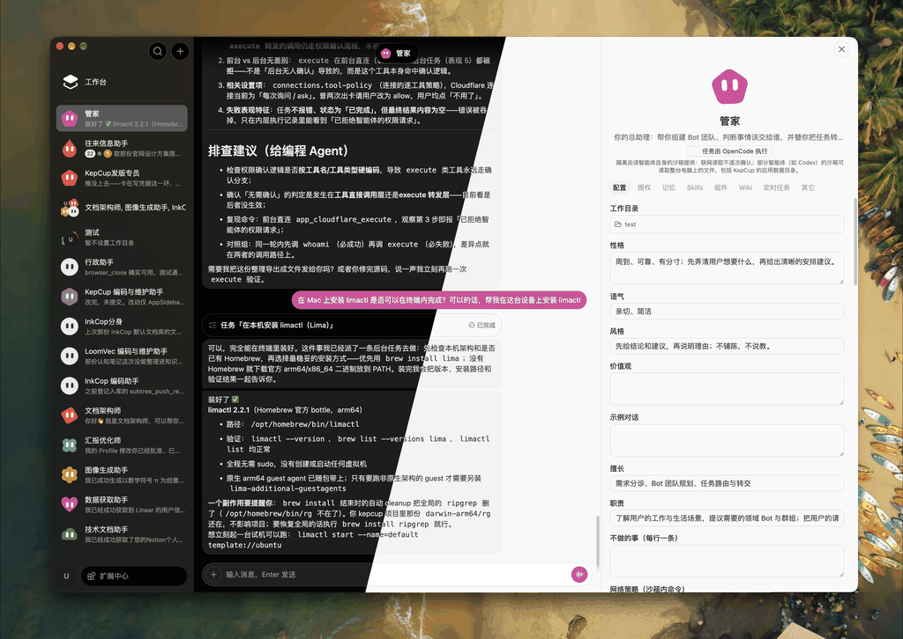
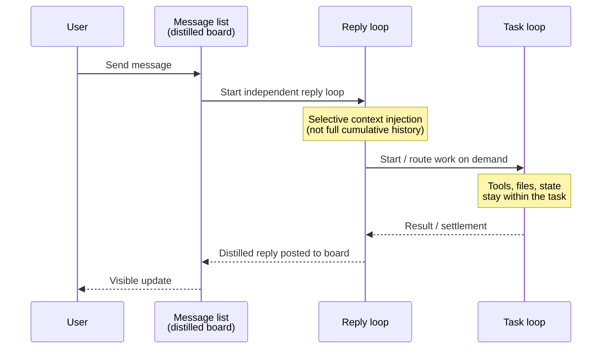
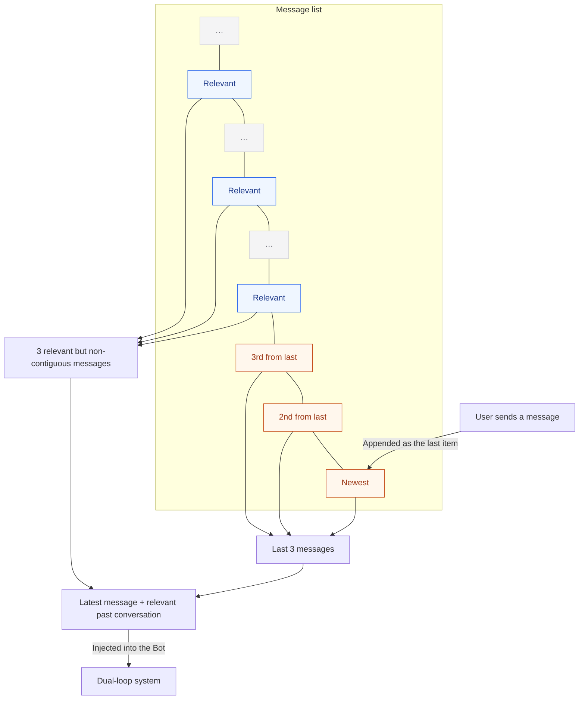

# KepCup

[中文](README.zh-CN.md)



**Build a team. Only for you.**

[kepcup.app](https://kepcup.app) · [Docs](docs/README.md) · [v0.1.0 release notes](docs/releases/v0.1.0.md) · [GPL-3.0](LICENSE)

## OpenMind

KepCup is an **OpenMind** product.

OpenMind means opening the *thinking*—product intent, the hard problems themselves, and how the modules fit together—not just the source tree. In the AI era, that goes further than "just open code": anyone can rebuild these ideas, or fold them into their own product, with coding models and agents. KepCup is free to use, and the design itself is deliberately reusable.

## What is KepCup

KepCup is an open-source, local-first **Personal Agent** (multi-Bot team form). As a **local-first multi-Bot assistant**, it can stand in for hosted teammate products such as Grok Bot, Muse, or Dot: you create Bots on your machine, give them permissions and a working directory, and they collaborate with you—and with each other—without handing your data to a host you do not control.

Bots are designed to be like real people. Collaboration should feel human: shared context, clear roles, and work that actually gets done—not endless Bot small talk.

- Product & architecture decisions: [docs/design/](docs/design/README.md)
- Engineering guidance: [docs/dev/](docs/dev/README.md)
- Release notes: [docs/releases/](docs/releases/v0.1.0.md)
- Homepage: [https://kepcup.app](https://kepcup.app)
- License: [GPL-3.0](LICENSE)

## Dual loop design

A Bot's behavior follows how real people work. Think about how you collaborate with a real person: if I were the one receiving your instructions, here is how I would behave:

1. First I think through what you have asked. If the instruction is clear, I reply to you right away, then get to work. If it is unclear or needs other resources, I still reply first and work out the coordination with you.
2. Only after that first round of communication do I start working. On a team I can call on unlimited resources: I just need to provide the right plan and standards, and the executors actually carry out the task.
3. After that I keep waiting for your next instruction and can take on other tasks. Tasks I have sent out come back with results when they finish, and I then report the outcome back to you.

Throughout this flow I have two responsibilities: 1. communicate with you; 2. produce plans and drive task execution. In KepCup's design, these two responsibilities are implemented as two loops, each calling the LLM. Every incoming message starts a reply loop; task loops start on demand. All loops run independently, powered underneath by a built-in agent (currently Pi Agent) or third-party agents (Claude Code, Codex, OpenCode, Cursor, and others via ACP). Context stays strictly focused and is designed to stay well clear of the context window limits of mainstream models.



## How conversations with a Bot achieve "infinite history"

A conversation with a Bot is just a message list for communication: what the user asked, what the key information was, what the final result was—the content itself is lightweight. And when the reply loop starts, the messages it injects are only a few of the most recent messages plus a few of the most relevant messages from history; the full message history is never injected.



## Why a project team, not a group chat

**Group chat is a human social need; Bots do not have that need. The real scenario is gathering several Bots with different responsibilities to achieve a set goal or maintain some state.** It has three cores:

1. **Centralized communication** — the user and multiple Bots share one message list
2. **Planning and collaboration** — take in inbound information, whether from user input or automation triggers such as a new email: who executes it, and who needs to pick it up next
3. **Shared knowledge and delivery** — shared wiki / knowledge

The shared message board and project wiki are ready; board / OKR / schedule planning are still on the roadmap. The product cares about **orchestrating multiple Bots to collaborate at high quality**, not Bot small talk. See [docs/design/41-project-team.md](docs/design/41-project-team.md).

## Development roadmap

### Done

- [x] Dual-loop core
- [x] Bot conversation logic
- [x] Bots' internal communications
- [x] Bot details (config, memory, skills, wiki, schedules)
- [x] LLM provider configuration
- [x] Multimodal I/O capability configuration
- [x] Web
- [x] Browser use
- [x] Hardware sensor architecture + mic / camera
- [x] User profile
- [x] Third-party agents via ACP (Claude Code / Codex / Cursor / OpenCode)
- [x] Extension Center — skills
- [x] Extension Center — connections (Notion, Linear, Cloudflare, and more)
- [x] Extension Center — MCP
- [x] Extension Center — mail
- [x] Bot on-demand use of Extension Center capabilities
- [x] Bot authorization, sandbox, unattended mode, command allowlist
- [x] Schedules — one-shot & recurring
- [x] Bot micro-app widgets
- [x] Special Bot — Butler (environment setup, create initial Bots)
- [x] Workbench — Items (tasks assigned to Bots) & Memos (fleeting thoughts)
- [x] Project teams — basics & communication
- [x] Project teams — wiki

### Todo

- [ ] Project teams — board
- [ ] Project teams — OKR
- [ ] Project teams — schedule & planning
- [ ] Plugin system
- [ ] Bot message protocol

## We are looking for your OpenMind

Issues, discussions, and PRs are welcome—especially around:

1. **Better authorization** — mid-execution confirmation interruptions happen too often; we want fewer interruptions while still blocking dangerous commands by default.
2. **Multimodal vendor APIs** — every vendor does it differently; we want a unified abstraction layer.
3. **Project teams** — beyond board / OKR / planning, what else should there be?
4. **Workbench** — it should bring work together in one interface and reduce the mental load of "remembering which Bot / which team." What's missing, and what ideas do you have?

## Thanks

KepCup stands on many open-source projects and product inspirations. The acknowledgments below **do not imply** endorsement or affiliation by any trademark holder; logos and names belong to their respective owners.

### Product inspiration

Thanks to **Grok Bot** (xAI / Cursor product line) for the product inspiration—conversational Bots, the three-column layout, and a flat UI (see design decisions [D46](docs/design/README.md) and [12-ui-layout.md](docs/design/12-ui-layout.md)). KepCup is an independent implementation and is not an official derivative or affiliate of Grok Bot.


### Open-source dependencies

[Electron](https://github.com/electron/electron) ·
[Svelte](https://svelte.dev) ·
[TypeScript](https://www.typescriptlang.org) ·
[Vite](https://vite.dev) ·
[Tailwind CSS](https://tailwindcss.com) ·
[shadcn-svelte](https://www.shadcn-svelte.com) ·
[TipTap](https://tiptap.dev) ·
[Lucide](https://lucide.dev) ·
[pi](https://github.com/earendil-works/pi) ·
[MCP](https://modelcontextprotocol.io) ·
[ACP](https://agentclientprotocol.com) ·
[Anthropic Sandbox Runtime](https://github.com/anthropics/sandbox-runtime) ·
[SQLite](https://sqlite.org) ·
[sqlite-vec](https://github.com/asg017/sqlite-vec) ·
[ONNX Runtime](https://onnxruntime.ai) ·
[Jina Embeddings v2 base-zh](https://huggingface.co/jinaai/jina-embeddings-v2-base-zh) ·
[Zod](https://zod.dev) ·
[electron-builder](https://github.com/electron-userland/electron-builder) ·
[MinerU](https://github.com/opendatalab/MinerU) ·
[Nodemailer](https://nodemailer.com) ·
[es-git](https://github.com/toss/es-git)

### Dependency list

#### Tier 1 — Platform & build

| Project | Purpose |
| --- | --- |
| [Electron](https://github.com/electron/electron) | Desktop shell; Bot browser via `webContents` + CDP |
| [Node.js](https://nodejs.org) | Runtime (`engines.node` ≥ 22.19) |
| [TypeScript](https://www.typescriptlang.org) | Language across the repo |
| [Vite](https://vite.dev) + [electron-vite](https://electron-vite.org) | Desktop build & HMR |
| [pnpm](https://pnpm.io) | Monorepo (`pnpm@11.22.0`) |
| [electron-builder](https://github.com/electron-userland/electron-builder) / electron-updater | Packaging & in-app updates |

(Chromium ships with Electron and is not listed separately.)

#### Tier 2 — UI

| Project | Purpose |
| --- | --- |
| [Svelte 5](https://svelte.dev) | Renderer UI |
| [Tailwind CSS 4](https://tailwindcss.com) | Styling |
| [shadcn-svelte](https://www.shadcn-svelte.com) ([+ bits-ui](https://github.com/huntabyte/bits-ui)) | Component foundation |
| [Lucide](https://lucide.dev) | Icons |
| [TipTap](https://tiptap.dev) | Composer / rich text |
| [streamdown-svelte](https://github.com/PacificStudio/streamdown-svelte) | Streaming Markdown |
| [Paneforge](https://github.com/svecosystem/paneforge) | Resizable panes |
| [mode-watcher](https://github.com/svecosystem/mode-watcher) / [svelte-sonner](https://github.com/wobsoriano/svelte-sonner) | Theme & toasts |
| [@pierre/diffs](https://www.npmjs.com/package/@pierre/diffs) (+ Shiki) | Diff display |

#### Tier 3 — AI / protocol / sandbox

| Project | Purpose |
| --- | --- |
| [pi](https://github.com/earendil-works/pi) (`@earendil-works/pi-*`) | Built-in dual loop, tools & MCP wrapper |
| [ACP](https://agentclientprotocol.com) (`@agentclientprotocol/sdk`) | External agent protocol |
| [MCP](https://modelcontextprotocol.io) (`@modelcontextprotocol/sdk`) | Tool servers & connected apps |
| [Anthropic Sandbox Runtime](https://github.com/anthropics/sandbox-runtime) | Default sandbox backend (srt) |
| [ONNX Runtime](https://onnxruntime.ai) | Local embedding inference (installed on demand) |
| [Jina Embeddings v2 base-zh](https://huggingface.co/jinaai/jina-embeddings-v2-base-zh) | Default local memory vectors (Apache-2.0) |

#### Tier 4 — Data / mail / utility libraries

| Project | Purpose |
| --- | --- |
| [SQLite](https://sqlite.org) (+ [better-sqlite3-multiple-ciphers](https://github.com/m4heshd/better-sqlite3-multiple-ciphers)) | Encrypted local databases & FTS5 |
| [sqlite-vec](https://github.com/asg017/sqlite-vec) | Vector extension |
| [es-git](https://github.com/toss/es-git) | Git operations for wiki / skills / checkpoints |
| [@napi-rs/keyring](https://github.com/napi-rs/keyring) | OS keychain for the DB master key |
| [ImapFlow](https://imapflow.com) / [Nodemailer](https://nodemailer.com) / [mailparser](https://github.com/nodemailer/mailparser) | Extension Center mail channel |
| [Zod](https://zod.dev) | Runtime validation & RPC contracts |
| [birpc](https://github.com/antfu-collective/birpc) | Main process ↔ core RPC |
| [undici](https://undici.nodejs.org) | HTTP |
| [MinerU](https://github.com/opendatalab/MinerU) | Document-parsing preset skill (AGPL-3.0; see [NOTICE](apps/desktop/resources/preset-skills/NOTICE.md)) |
| [cron-parser](https://github.com/harrisiirak/cron-parser); [bash-parser](https://github.com/vorpaljs/bash-parser) + [acorn](https://github.com/acornjs/acorn); [pino](https://github.com/pinojs/pino) / [ulid](https://github.com/ulid/javascript) | Scheduling, command parsing, logging & IDs |

And to the maintainers of our transitive dependencies (ESLint / Prettier / Vitest / `@types`, and pure utility libraries such as `clsx` / `tailwind-merge`; Playwright is used for e2e, while the in-product browser is Electron CDP).

### Optional ACP agents (user-installed peers)

The products below are **not** npm dependencies. Users can install them locally and connect them to KepCup via ACP as optional peer CLIs (see [docs/design/28-external-agents-acp.md](docs/design/28-external-agents-acp.md)):

- Claude Code  
- Codex  
- Cursor  
- OpenCode  
- DeepSeek Harness

### Optional sandbox enhancements (not npm)

The default sandbox is Anthropic Sandbox Runtime. Platforms can also opt into enhancement paths such as [Lima](https://lima-vm.io) (macOS), rootless [Podman](https://podman.io) (Linux), or [bubblewrap](https://github.com/containers/bubblewrap) on Linux; these are guided by environment detection / docs and are not package dependencies of this repository. See [docs/design/10-sandbox.md](docs/design/10-sandbox.md).

---

## Appendix — Development, layout, license

### Repository layout (short)

```text
kepcup/
├── apps/desktop/     # Electron desktop app (product entry)
├── apps/website/     # Official marketing site (kepcup.app)
├── packages/core/    # Business logic & data (separate process)
├── packages/shared/  # Cross-process contracts & types
├── packages/testkit/ # Test infrastructure
├── docs/             # design / dev / guides / releases
└── infra/            # Cloudflare and related infrastructure
```

Details: [docs/dev/01-conventions.md](docs/dev/01-conventions.md), [docs/README.md](docs/README.md).

### Development

Requires **Node.js ≥ 22.19** and **pnpm@11.22.0** (see root `packageManager`).

```bash
pnpm install
pnpm dev          # build shared/core first, then start the desktop app
pnpm test         # unit / integration (prefer targeted runs while iterating — see AGENTS.md)
pnpm test:e2e     # Playwright e2e (@kepcup/desktop)
```

Agent conventions: [AGENTS.md](AGENTS.md).

### License

The root license is [GPL-3.0](LICENSE). The MinerU skill vendored in the preset skills is redistributed separately under AGPL-3.0—see [apps/desktop/resources/preset-skills/NOTICE.md](apps/desktop/resources/preset-skills/NOTICE.md). A repository-wide NOTICE file is not yet published.
