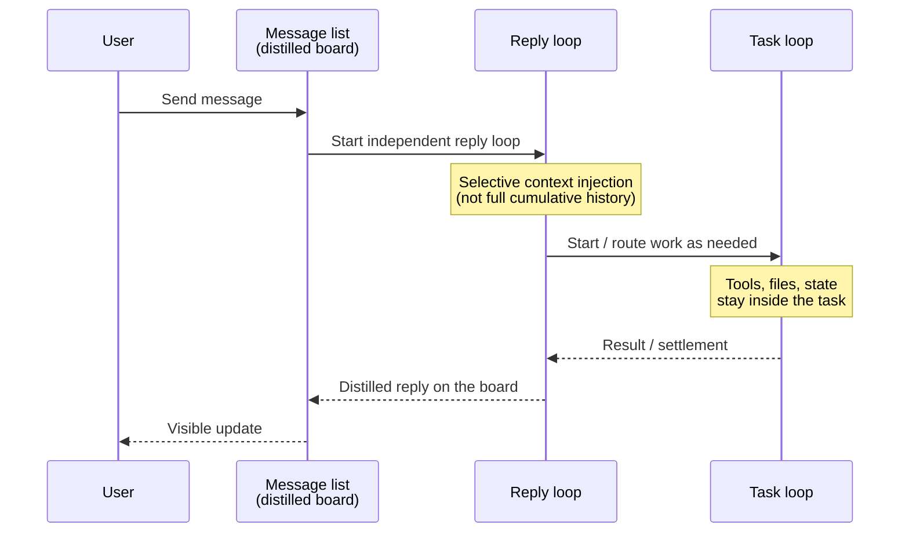
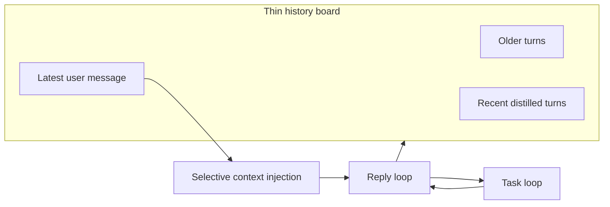

# KepCup

[中文](README.zh-CN.md)

<p align="center">
  
</p>

<p align="center"><strong>Build a team. Only for you.</strong></p>

<p align="center">
  <a href="https://kepcup.app">kepcup.app</a> ·
  <a href="docs/README.md">Docs</a> ·
  <a href="docs/releases/v0.1.0.md">v0.1.0 release notes</a> ·
  <a href="LICENSE">GPL-3.0</a>
</p>

## OpenMind

KepCup is an **OpenMind** product.

OpenMind means opening the *thinking*—product intent, the hard problems, and how the modules fit together—not only the source tree. In the AI era that goes further than code alone: anyone can rebuild these ideas, or fold them into their own product, with coding models and agents. KepCup is free to use, and the design is meant to be reusable.

## What is KepCup

KepCup is a **local-first multi-Bot assistant**. It can stand in for hosted teammate products such as Grok Bot, Muse, or Dot: you create Bots on your machine, give them permissions and a working directory, and they collaborate with you—and with each other—without shipping your data to a host you do not control.

Bots are designed like real people. Collaboration should feel human: shared context, clear roles, and work that actually ships—not endless Bot chitchat.

- Product & architecture decisions: [docs/design/](docs/design/README.md)
- Engineering guidance: [docs/dev/](docs/dev/README.md)
- Release notes: [docs/releases/](docs/releases/v0.1.0.md)
- Homepage: [https://kepcup.app](https://kepcup.app)
- License: [GPL-3.0](LICENSE)

## Dual loop

A Bot’s dual loop mirrors how people work.

- The **message list** is a long-term, distilled communication surface—what you and the Bot agreed to remember as the conversation.
- Each user message starts an independent **reply** loop. That loop does **not** stack cumulative raw chat history as its working context.
- **Task execution** is a separate loop. Tool use, files, and intermediate state stay inside that task.



## One conversation, infinite history

The UI keeps a **thin history board**. The dual loop injects only the context that turn needs—so a conversation can grow without every reply replaying the entire transcript.



## Project teams (not group chat)

A **project team** is not a group chat. It has three cores:

1. **Centralized communication** — you and the Bots in one place  
2. **Plans & collaboration** — who owns what, and how work moves  
3. **Shared knowledge and delivery** — shared wiki / knowledge, and getting work done  

Shared message board and project wiki are in; board / OKR / date planning are still on the roadmap. The product is about **shipping work**, not Bot small talk. See [docs/design/41-project-team.md](docs/design/41-project-team.md).

## Development roadmap

### Done

- [x] Dual-loop core
- [x] Bot conversation logic
- [x] Bots’ internal communications
- [x] Bot details (config, memory, skills, wiki, schedules)
- [x] LLM provider configuration
- [x] Multimodal I/O capability configuration
- [x] Web
- [x] Browser use
- [x] Hardware sensor architecture + mic / camera
- [x] User profile
- [x] Third-party agents via ACP (Claude Code / Codex / Cursor / OpenCode)
- [x] Extension Center — skills
- [x] Extension Center — connections (Notion, Linear, Cloudflare, and more)
- [x] Extension Center — MCP
- [x] Extension Center — mail
- [x] Bot on-demand Extension Center capabilities
- [x] Bot auth, sandbox, unattended mode, command allowlist
- [x] Schedules — one-shot & recurring
- [x] Bot micro-app widgets
- [x] Special Bot — Butler (env init, create initial Bots)
- [x] Workbench — Items (tasks to Bots) & Memos (fleeting notes)
- [x] Project teams — basics & communication
- [x] Project teams — wiki

### Todo

- [ ] Project teams — board
- [ ] Project teams — OKR
- [ ] Project teams — dates & planning
- [ ] Plugin system
- [ ] Bot message protocol

## We are looking for your OpenMind

Open issues, discussions, or PRs—especially around:

1. **Better authorization** — mid-run prompts interrupt too often; we want less interruption while still blocking dangerous commands by default.  
2. **Multimodal vendor APIs** — providers disagree; we want a unified layer.  
3. **Project teams** — what else should they have beyond board / OKR / planning?  
4. **Workbench** — it should surface work in one UI and cut the “remember which Bots / teams” load. What’s missing?

## Thanks

KepCup stands on many open-source projects and product inspirations. This acknowledgment **does not imply** endorsement or affiliation by any trademark holder; marks and names belong to their respective owners.

### Product inspiration

Thanks to **Grok Bot** (xAI / Cursor product line) for product inspiration—conversational Bots, the three-column layout, and a flat UI (see design decision [D46](docs/design/README.md) and [12-ui-layout.md](docs/design/12-ui-layout.md)). KepCup is an independent implementation, not an official derivative or affiliate of Grok Bot.

<!-- PENDING_GROK_BOT_LOGO: full-width horizontal Grok Bot logo.
     Awaiting an official asset confirmed for third-party README use
     (xAI/Cursor brand guidelines: official provided assets only, no
     alteration, no endorsement implication). Do not substitute
     unofficial SVGs (e.g. asvg.app) or reconstructed marks. -->

*PENDING — Full-width horizontal Grok Bot logo: replace this placeholder once Pengfei supplies an officially confirmed asset cleared for third-party README use.*

Ideas were also informed by [Rakazo](https://github.com/elie222/rakazo), [OpenMuse](https://github.com/CopilotKit/OpenMuse), and [OpenDots](https://github.com/CopilotKit/OpenDots) (local / self-hosted assistant directions). They are **not** runtime dependencies of this repository and are omitted from the open-source matrix below.

### Open-source dependencies (logo matrix)

For v1 we use **names + upstream links only** (no embedded third-party marks until brand clearance is confirmed; no unofficial logo CDNs):

[Electron](https://github.com/electron/electron) ·
[Svelte](https://svelte.dev) ·
[TypeScript](https://www.typescriptlang.org) ·
[Vite](https://vite.dev) ·
[Tailwind CSS](https://tailwindcss.com) ·
[shadcn-svelte](https://www.shadcn-svelte.com) ·
[TipTap](https://tiptap.dev) ·
[Lucide](https://lucide.dev) ·
[pi](https://github.com/earendil-works/pi) ·
[MCP](https://modelcontextprotocol.io) ·
[ACP](https://agentclientprotocol.com) ·
[Anthropic Sandbox Runtime](https://github.com/anthropics/sandbox-runtime) ·
[SQLite](https://sqlite.org) ·
[sqlite-vec](https://github.com/asg017/sqlite-vec) ·
[ONNX Runtime](https://onnxruntime.ai) ·
[Jina Embeddings v2 base-zh](https://huggingface.co/jinaai/jina-embeddings-v2-base-zh) ·
[Zod](https://zod.dev) ·
[electron-builder](https://github.com/electron-userland/electron-builder) ·
[MinerU](https://github.com/opendatalab/MinerU) ·
[Nodemailer](https://nodemailer.com) ·
[es-git](https://github.com/toss/es-git)

### Dependency list

#### Tier 1 — Platform & build

| | Project | Why |
| --- | --- | --- |
| | [Electron](https://github.com/electron/electron) | Desktop shell; Bot browser via `webContents` + CDP |
| | [Node.js](https://nodejs.org) | Runtime (`engines.node` ≥ 22.19) |
| | [TypeScript](https://www.typescriptlang.org) | Whole codebase |
| | [Vite](https://vite.dev) + [electron-vite](https://electron-vite.org) | Desktop build / HMR |
| | [pnpm](https://pnpm.io) | Monorepo (`pnpm@11.22.0`) |
| | [electron-builder](https://github.com/electron-userland/electron-builder) / electron-updater | Packaging + auto-update |

(Chromium ships with Electron—no separate cell.)

#### Tier 2 — UI

| | Project | Why |
| --- | --- | --- |
| | [Svelte 5](https://svelte.dev) | Renderer UI |
| | [Tailwind CSS 4](https://tailwindcss.com) | Styling |
| | [shadcn-svelte](https://www.shadcn-svelte.com) ([+ bits-ui](https://github.com/huntabyte/bits-ui)) | Component base |
| | [Lucide](https://lucide.dev) | Icons |
| | [TipTap](https://tiptap.dev) | Composer / rich text |
| | [streamdown-svelte](https://github.com/PacificStudio/streamdown-svelte) | Streaming Markdown |
| | [Paneforge](https://github.com/svecosystem/paneforge) | Resizable panes |
| | [mode-watcher](https://github.com/svecosystem/mode-watcher) / [svelte-sonner](https://github.com/wobsoriano/svelte-sonner) | Theme + toasts |
| | [@pierre/diffs](https://www.npmjs.com/package/@pierre/diffs) (+ Shiki) | Diff UI |

#### Tier 3 — AI / protocol / sandbox

| | Project | Why |
| --- | --- | --- |
| | [pi](https://github.com/earendil-works/pi) (`@earendil-works/pi-*`) | Built-in dual-loop / tools / MCP wrapper |
| | [ACP](https://agentclientprotocol.com) (`@agentclientprotocol/sdk`) | External agent protocol |
| | [MCP](https://modelcontextprotocol.io) (`@modelcontextprotocol/sdk`) | Tool servers & connected apps |
| | [Anthropic Sandbox Runtime](https://github.com/anthropics/sandbox-runtime) | Default sandbox backend (srt) |
| | [ONNX Runtime](https://onnxruntime.ai) | Local embeddings (on-demand install) |
| | [Jina Embeddings v2 base-zh](https://huggingface.co/jinaai/jina-embeddings-v2-base-zh) | Default local memory vectors (Apache-2.0) |

#### Tier 4 — Data / mail / utilities

| | Project | Why |
| --- | --- | --- |
| | [SQLite](https://sqlite.org) (+ [better-sqlite3-multiple-ciphers](https://github.com/m4heshd/better-sqlite3-multiple-ciphers)) | Encrypted local DBs / FTS5 |
| | [sqlite-vec](https://github.com/asg017/sqlite-vec) | Vector extension |
| | [es-git](https://github.com/toss/es-git) | Wiki / skills / checkpoints |
| | [@napi-rs/keyring](https://github.com/napi-rs/keyring) | OS keychain for DB master key |
| | [ImapFlow](https://imapflow.com) / [Nodemailer](https://nodemailer.com) / [mailparser](https://github.com/nodemailer/mailparser) | Extension Center email |
| | [Zod](https://zod.dev) | Runtime validation & RPC contracts |
| | [birpc](https://github.com/antfu-collective/birpc) | Main ↔ core RPC |
| | [undici](https://undici.nodejs.org) | HTTP |
| | [MinerU](https://github.com/opendatalab/MinerU) | Document-parsing preset skill (AGPL-3.0; see [NOTICE](apps/desktop/resources/preset-skills/NOTICE.md)) |
| | [cron-parser](https://github.com/harrisiirak/cron-parser); [bash-parser](https://github.com/vorpaljs/bash-parser) + [acorn](https://github.com/acornjs/acorn); [pino](https://github.com/pinojs/pino) / [ulid](https://github.com/ulid/javascript) | Schedules, command parsing, logging & IDs |

…and the maintainers of our transitive dependencies (ESLint / Prettier / Vitest / `@types`, small helpers such as `clsx` / `tailwind-merge`, and similar are intentionally not listed one-by-one; Playwright is e2e-only—the in-product browser is Electron CDP).

### Optional ACP agents (user-installed peers)

These are **not** npm dependencies and are **not** in the open-source logo matrix. Users may install them locally and connect them through ACP as optional peer CLIs (see [docs/design/28-external-agents-acp.md](docs/design/28-external-agents-acp.md)):

- Claude Code  
- Codex  
- Cursor  
- OpenCode  
- DeepSeek Harness  

### Optional sandbox enhancements (not npm)

The default sandbox is Anthropic Sandbox Runtime. Platforms may also use [Lima](https://lima-vm.io) (macOS), rootless [Podman](https://podman.io) (Linux), or [bubblewrap](https://github.com/containers/bubblewrap) on Linux as optional enhancements—guided by environment detection / docs, not package dependencies. See [docs/design/10-sandbox.md](docs/design/10-sandbox.md).

---

## Appendix — Develop, layout, license

### Repository layout (short)

```text
kepcup/
├── apps/desktop/     # Electron desktop app (product entry)
├── apps/website/     # Official marketing site (kepcup.app)
├── packages/core/    # Business logic & data (separate process)
├── packages/shared/  # Cross-process contracts & types
├── packages/testkit/ # Test infrastructure
├── docs/             # design / dev / guides / releases
└── infra/            # Cloudflare helpers and related
```

Details: [docs/dev/01-conventions.md](docs/dev/01-conventions.md), [docs/README.md](docs/README.md).

### Develop

Requires **Node.js ≥ 22.19** and **pnpm@11.22.0** (see root `packageManager`).

```bash
pnpm install
pnpm dev          # build shared/core, then start the desktop app
pnpm test         # unit / integration (prefer targeted runs while iterating — see AGENTS.md)
pnpm test:e2e     # Playwright e2e (@kepcup/desktop)
```

Agent conventions: [AGENTS.md](AGENTS.md).

### License

Root license: [GPL-3.0](LICENSE). The vendored MinerU preset skill is redistributed under AGPL-3.0—see [apps/desktop/resources/preset-skills/NOTICE.md](apps/desktop/resources/preset-skills/NOTICE.md). A repository-wide NOTICE file is not yet published.
