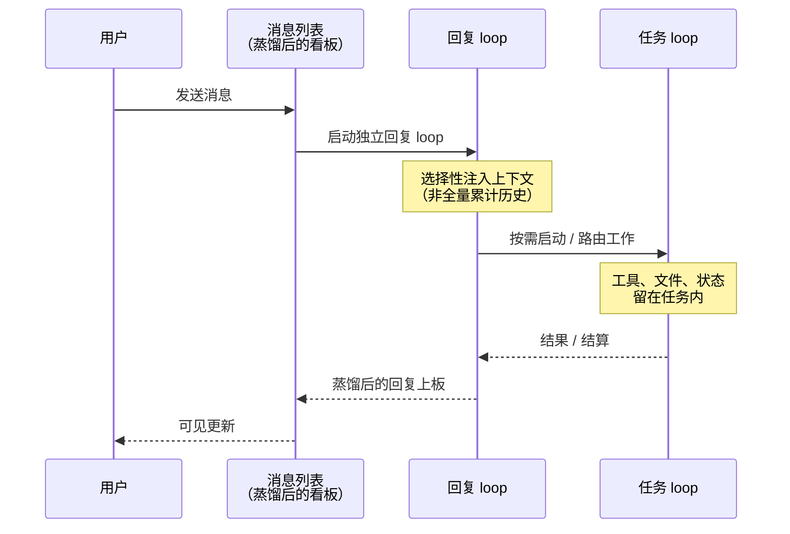
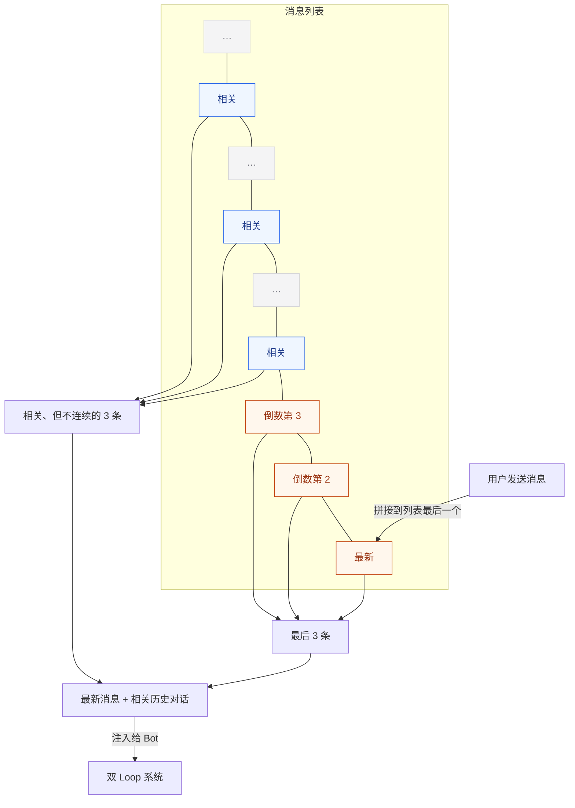

# KepCup

[English](README.md)


**创建一个团队，只为你服务！**

[kepcup.app](https://kepcup.app) · 文档 · v0.1.0 发行说明 · [GPL-3.0](LICENSE)

## OpenMind

KepCup 是一款 **OpenMind** 产品。

OpenMind 指的是开放*思考*——产品意图、难题本身，以及模块如何咬合——而不只是开放源码树。在 AI 时代，这一点比「只开代码」走得更远：任何人都可以用编程模型与智能体重建这些想法，或把它们折叠进自己的产品。KepCup 可免费使用，设计本身也刻意做成可复用的。

## 什么是 KepCup

KepCup 是开源、本地优先的 **Personal Agent**（多 Bot 团队形态）。作为**本地优先的多 Bot 助手**，它可以替代托管式队友产品（如 Grok Bot、Muse、Dot）：你在本机创建 Bot，赋予权限与工作目录，它们与你协作、彼此协作——而无需把数据交给你无法掌控的主机。

Bot 按真人来设计。协作应当有人味：共享上下文、角色清晰、把事情真正做完——而不是没完没了的 Bot 闲聊。

- 产品与架构决策：[docs/design/](docs/design/README.md)
- 工程指导：[docs/dev/](docs/dev/README.md)
- 发行说明：[docs/releases/](docs/releases/v0.1.0.md)
- 主页：[https://kepcup.app](https://kepcup.app)
- 许可：[GPL-3.0](LICENSE)

## 双 Loop 设计

Bot 的行为逻辑参考真人——想象一下你与真人是如何协作的，假如我就是接受你指令的人，我的行为逻辑应该是：

1. 先思考你交代的内容，如果指令清晰，马上回复你一句，然后再去干活，如果指令不清晰或者需要其它资源，那么依然先回复你，与你商量配合的问题。
2. 与你完成第一轮沟通之后，再开始干活，我在团队中，能调用无尽的资源，我只需要给出正确的规划和标准，然后任务由执行者真正执行。
3. 之后我会继续等待你的新指令，可以继续接受其它任务，而外发出去的任务，执行完毕后我会收到结果，此时我会再想你汇报任务执行结果。

整个流程中，我的职责有两个：1. 与你沟通；2. 出规划、驱动任务执行。在 KepCup 的设计中，这两个职责，设计成两个 Loop 调用 LLM 来执行，每收到一条消息，就启动回复 loop，按需启动任务 loop，并且，所有 loop 都是独立运行，底层有内置智能体（当前是 Pi Agent）或第三方智能体（由ACP协议驱动 Claude Code、Codex、OpenCode、Cursor 等）执行，上下文绝对聚焦且设计上就很难碰到主流大模型的上下文窗口。



## 与 Bot 的对话如何实现“无限历史”

与 Bot 的对话，只是沟通的消息列表，用户的指令是什么，关键信息是什么，最终结果是什么，内容本身就很轻量，同时，回复 loop 启动时注入的消息，只提取最近若干条和历史中最相关的若干条，完整的消息历史并不注入。



## 为什么是项目组，而不是群聊

**群聊，是人类的社交需要，Bot 并没有这个需求，真实的场景是，聚集多个不同职责的 Bot 去完成既定目标或维护某个状态**。它有三个核心：

1. **集中沟通** — 用户、多个 Bots 共用一个消息列表
2. **计划与协作** — 接受流入信息，如用户输入的、或者自动化触发的，例如新邮件，谁来执行，后续需要谁来接力
3. **共享知识与交付** — 共享 wiki / 知识

共享消息板与项目 wiki 已就绪；看板 / OKR / 日程规划仍在路线图上。产品关心的是**调度多个 Bots 高质量协作**，不是 Bot 闲聊。详见 [docs/design/41-project-team.md](docs/design/41-project-team.md)。

## 开发路线图

### 已完成

- [x] 双 loop 核心
- [x] Bot 对话逻辑
- [x] Bot 之间的内部沟通
- [x] Bot 详情（配置、记忆、技能、wiki、定时）
- [x] LLM 供应商配置
- [x] 多模态 I/O 能力配置
- [x] Web
- [x] 浏览器使用
- [x] 硬件传感器架构 + 麦克风 / 摄像头
- [x] 用户画像
- [x] 经 ACP 接入第三方智能体（Claude Code / Codex / Cursor / OpenCode）
- [x] 扩展中心 — 技能
- [x] 扩展中心 — 连接（Notion、Linear、Cloudflare 等）
- [x] 扩展中心 — MCP
- [x] 扩展中心 — 邮件
- [x] Bot 按需使用扩展中心能力
- [x] Bot 授权、沙箱、无人值守、命令白名单
- [x] 定时 — 单次与周期
- [x] Bot 微应用组件（widgets）
- [x] 特殊 Bot — 管家（环境初始化、创建初始 Bot）
- [x] 工作台 — 事项（派给 Bot 的任务）与备忘（闪念）
- [x] 项目组 — 基础与沟通
- [x] 项目组 — wiki

### 待办

- [ ] 项目组 — 看板
- [ ] 项目组 — OKR
- [ ] 项目组 — 日程与规划
- [ ] 插件系统
- [ ] Bot 消息协议

## 我们在寻找你的 OpenMind

欢迎提 Issue、讨论或 PR——尤其关心：

1. **更好的授权** — 执行中途的确认打断太多；我们希望少打断，同时默认仍拦住危险命令。
2. **多模态厂商 API** — 各家不一致；我们想要一层统一抽象。
3. **项目组** — 除了看板 / OKR / 规划，还该有什么？
4. **工作台** — 应在同一界面汇集工作，减轻「记住哪个 Bot / 哪个组」的心智负担。还缺什么，你有什么好想法？

## 感谢

KepCup 站在许多开源项目与产品灵感之上。以下致谢**不暗示**任何商标方的背书或隶属关系；标志与名称分属各自权利人。

### 产品灵感

感谢 **Grok Bot**（xAI / Cursor 产品线）提供的产品创意灵感——对话式 Bot、三栏布局与扁平 UI（见设计决策 [D46](docs/design/README.md) 与 [12-ui-layout.md](docs/design/12-ui-layout.md)）。KepCup 是独立实现，并非 Grok Bot 的官方衍生或附属产品。


### 开源依赖

[Electron](https://github.com/electron/electron) ·
[Svelte](https://svelte.dev) ·
[TypeScript](https://www.typescriptlang.org) ·
[Vite](https://vite.dev) ·
[Tailwind CSS](https://tailwindcss.com) ·
[shadcn-svelte](https://www.shadcn-svelte.com) ·
[TipTap](https://tiptap.dev) ·
[Lucide](https://lucide.dev) ·
[pi](https://github.com/earendil-works/pi) ·
[MCP](https://modelcontextprotocol.io) ·
[ACP](https://agentclientprotocol.com) ·
[Anthropic Sandbox Runtime](https://github.com/anthropics/sandbox-runtime) ·
[SQLite](https://sqlite.org) ·
[sqlite-vec](https://github.com/asg017/sqlite-vec) ·
[ONNX Runtime](https://onnxruntime.ai) ·
[Jina Embeddings v2 base-zh](https://huggingface.co/jinaai/jina-embeddings-v2-base-zh) ·
[Zod](https://zod.dev) ·
[electron-builder](https://github.com/electron-userland/electron-builder) ·
[MinerU](https://github.com/opendatalab/MinerU) ·
[Nodemailer](https://nodemailer.com) ·
[es-git](https://github.com/toss/es-git)

### 依赖列表

#### Tier 1 — 平台与构建

| 项目 | 用途 |
| --- | --- |
| [Electron](https://github.com/electron/electron) | 桌面壳；Bot 浏览器经 `webContents` + CDP |
| [Node.js](https://nodejs.org) | 运行时（`engines.node` ≥ 22.19） |
| [TypeScript](https://www.typescriptlang.org) | 全仓语言 |
| [Vite](https://vite.dev) + [electron-vite](https://electron-vite.org) | 桌面构建与 HMR |
| [pnpm](https://pnpm.io) | Monorepo（`pnpm@11.22.0`） |
| [electron-builder](https://github.com/electron-userland/electron-builder) / electron-updater | 打包与应用内更新 |

（Chromium 随 Electron 提供，不单列。）

#### Tier 2 — 界面

| 项目 | 用途 |
|  --- | --- |
| [Svelte 5](https://svelte.dev) | 渲染进程 UI |
| [Tailwind CSS 4](https://tailwindcss.com) | 样式 |
| [shadcn-svelte](https://www.shadcn-svelte.com)（[+ bits-ui](https://github.com/huntabyte/bits-ui)） | 组件基座 |
| [Lucide](https://lucide.dev) | 图标 |
| [TipTap](https://tiptap.dev) | 输入区富文本 / Composer |
| [streamdown-svelte](https://github.com/PacificStudio/streamdown-svelte) | 流式 Markdown |
| [Paneforge](https://github.com/svecosystem/paneforge) | 可拖拽分栏 |
| [mode-watcher](https://github.com/svecosystem/mode-watcher) / [svelte-sonner](https://github.com/wobsoriano/svelte-sonner) | 主题与 Toast |
| [@pierre/diffs](https://www.npmjs.com/package/@pierre/diffs)（+ Shiki） | Diff 展示 |

#### Tier 3 — AI / 协议 / 沙箱

| 项目 | 用途 |
|  --- | --- |
| [pi](https://github.com/earendil-works/pi)（`@earendil-works/pi-*`） | 内置双 loop、工具与 MCP 包装 |
| [ACP](https://agentclientprotocol.com)（`@agentclientprotocol/sdk`） | 外部智能体协议 |
| [MCP](https://modelcontextprotocol.io)（`@modelcontextprotocol/sdk`） | 工具服务器与连接应用 |
| [Anthropic Sandbox Runtime](https://github.com/anthropics/sandbox-runtime) | 默认沙箱后端（srt） |
| [ONNX Runtime](https://onnxruntime.ai) | 本地 embedding 推理（按需安装） |
| [Jina Embeddings v2 base-zh](https://huggingface.co/jinaai/jina-embeddings-v2-base-zh) | 默认本地记忆向量（Apache-2.0） |

#### Tier 4 — 数据 / 邮件 / 工具库

| 项目 | 用途 |
|  --- | --- |
| [SQLite](https://sqlite.org)（+ [better-sqlite3-multiple-ciphers](https://github.com/m4heshd/better-sqlite3-multiple-ciphers)） | 加密本地库与 FTS5 |
| [sqlite-vec](https://github.com/asg017/sqlite-vec) | 向量扩展 |
| [es-git](https://github.com/toss/es-git) | Wiki / 技能 / 检查点的 Git 操作 |
| [@napi-rs/keyring](https://github.com/napi-rs/keyring) | 系统钥匙串存放 DB 主密钥 |
| [ImapFlow](https://imapflow.com) / [Nodemailer](https://nodemailer.com) / [mailparser](https://github.com/nodemailer/mailparser) | 扩展中心邮件通道 |
| [Zod](https://zod.dev) | 运行时校验与 RPC 契约 |
| [birpc](https://github.com/antfu-collective/birpc) | 主进程 ↔ core RPC |
| [undici](https://undici.nodejs.org) | HTTP |
| [MinerU](https://github.com/opendatalab/MinerU) | 文档解析预置技能（AGPL-3.0；见 [NOTICE](apps/desktop/resources/preset-skills/NOTICE.md)） |
| [cron-parser](https://github.com/harrisiirak/cron-parser)；[bash-parser](https://github.com/vorpaljs/bash-parser) + [acorn](https://github.com/acornjs/acorn)；[pino](https://github.com/pinojs/pino) / [ulid](https://github.com/ulid/javascript) | 定时、命令解析、日志与 ID |

以及我们传递依赖的各位维护者（ESLint / Prettier / Vitest / `@types`、纯工具库如 `clsx` / `tailwind-merge` 等；Playwright 用于 e2e，产品内浏览器 Electron CDP）。

### Optional ACP agents（user-installed peers）

下列产品**不是** npm 依赖，用户可在本机安装后，经 ACP 作为可选 peer CLI 接入 KepCup（见 [docs/design/28-external-agents-acp.md](docs/design/28-external-agents-acp.md)）：

- Claude Code  
- Codex  
- Cursor  
- OpenCode  
- DeepSeek Harness

### 可选沙箱增强（非 npm）

默认沙箱为 Anthropic Sandbox Runtime。平台上还可选 [Lima](https://lima-vm.io)（macOS）、rootless [Podman](https://podman.io)（Linux）或 Linux 上的 [bubblewrap](https://github.com/containers/bubblewrap) 等增强路径；它们由环境检测 / 文档引导，不是本仓库的 package 依赖。详见 [docs/design/10-sandbox.md](docs/design/10-sandbox.md)。

---

## 附录 — 开发、结构、许可

### 仓库结构（简）

```text
kepcup/
├── apps/desktop/     # Electron 桌面应用（产品入口）
├── apps/website/     # 官方营销站（kepcup.app）
├── packages/core/    # 业务逻辑与数据（独立进程）
├── packages/shared/  # 跨进程契约与类型
├── packages/testkit/ # 测试基建
├── docs/             # design / dev / guides / releases
└── infra/            # Cloudflare 等配套
```

细节见 [docs/dev/01-conventions.md](docs/dev/01-conventions.md)、[docs/README.md](docs/README.md)。

### 开发

需要 **Node.js ≥ 22.19** 与 **pnpm@11.22.0**（见根 `packageManager`）。

```bash
pnpm install
pnpm dev          # 先构建 shared/core，再启动桌面应用
pnpm test         # 单元 / 集成（迭代中请先定向跑，见 AGENTS.md）
pnpm test:e2e     # Playwright e2e（@kepcup/desktop）
```

编程代理约定见 [AGENTS.md](AGENTS.md)。

### 许可

根许可为 [GPL-3.0](LICENSE)。预置技能中 vendored 的 MinerU 技能单独以 AGPL-3.0 再分发，说明见 [apps/desktop/resources/preset-skills/NOTICE.md](apps/desktop/resources/preset-skills/NOTICE.md)。仓库级 NOTICE 尚未单列。
