# 33 窄屏单栏布局（Narrow layout）

KepCup 允许用户把主窗口拉窄到手机宽度（内容宽最小 375px，[main/window.ts](../../apps/desktop/src/main/window.ts)）。窄屏布局把这时的界面从「左栏 + 聊天区 + 右栏」桌面三栏切换为**手机式单栏**：一屏一页、底部全局 tab 导航、详情层带返回。目的有两个：桌面上的**侧边辅助 Panel**形态（用户操作其它软件时把窄屏 KepCup 靠在旁边），以及为**未来移动端**沉淀导航模型与页面结构。决策编号 **D82**。

**状态：已实现（2026-10-11）。** 单测（`narrow-layout.test.ts`）与 e2e（`test/e2e/narrow-layout.spec.ts`）全绿，8 个关键状态的截图经像素级视觉复核通过。

相关：[12-ui-layout.md](12-ui-layout.md)（宽屏布局基线）、[29 §16 扩展中心](29-connected-apps.md)（分组主体复用）、D70 管家（列表置顶逻辑在窄屏同样生效）。

## 决策

- **D82 窄屏单栏布局**：
  1. **断点与切换**：窗口内容宽 **< 640px** 进入窄屏模式。宽度监听用 Svelte 的 `<svelte:window bind:innerWidth>`（resize 逐帧回填，纯响应式；不用 matchMedia——其 `change` 监听在部分环境拖拽窗口时不触发，切换滞后到刷新）。640 右端点开区间与 Tailwind `sm:`（`min-width: 640px`）恰互补，两边判定永不重叠。宽 / 窄是同一窗口的两种形态，随拉伸即时切换、不持久化；拉回宽屏时 Bot 详情覆盖层复位（宽屏没有这一层，右栏开合归 `shell.rightPanelCollapsed`）。
  2. **导航模型（未来移动端的参考）**：两层。第一层是**底部全局 tab**：**对话 / 通讯录 / 扩展 / 我**；第二层是**详情层**——对话 tab 内的会话列表 → 会话详情，以及会话详情顶部的 **Bot 详情覆盖层**（宽屏右栏的 RightPanel 内容，全屏 `fixed inset-0`）。进入详情层**底部 tab 栏隐藏**，会话详情**左上角出现返回按钮**；详情层内无法直接切 tab（出详情只能走返回或药丸），这是刻意的——避免详情层叠详情层。tab 页顶部只有与红绿灯等高的**空白拖拽带**（不渲染标题——红绿灯压字；高度保留，否则下方元素上移仍被盖住）。
  3. **内容提取**：通讯录 tab = 设置的「通讯录」分区（ContactsSection），我 tab = 「用户画像」分区（ProfileSection）+ 设置入口。**设置在窄屏是全屏页（NarrowSettings），不再是弹框**：分组列表占一页，点条目进分组详情页（左上角返回，Esc 详情页回列表、列表页关页面）；列表隐藏这两项（`NARROW_HIDDEN_SETTINGS_SECTIONS`）。入口统一走 `shell.openSettings`：窄屏不带分区落列表页，带分区（经 `resolveSettingsSection` 展开别名后）直达详情页，通讯录 / 用户画像深链直接切 tab。分区清单与内容视图与宽屏弹框共用（`settings-sections-list.ts` / `SettingsSectionView.svelte`），弹框只在宽屏使用。
  4. **扩展中心去弹框化**：窄屏下「扩展」tab 整页呈现分组主体（`ExtensionCenterBody`，与弹框共用；弹框只在宽屏使用），所有 `shell.openExtensionCenter` 深链（设置「应用 → 去添加」、技能面板等）由 NarrowShell 统一**重路由**到扩展 tab。分组主体自身不带水平内边距（弹框形态由 DialogContent 的 `p-4` 提供），页面形态由页面骨架补 `px-4`。**卡片网格窄屏单列**：技能（ExtensionSkills）与连接目录（AppCatalogGrid）的网格基准 `grid-cols-1`，容器查询断点 `@xl` 起恢复 2–4 列（弹框宽度下的观感不变）；通讯录名册等裸 `grid` 一律补显式 `grid-cols-1`——auto 轨道按内容 `min-content` 取宽，`truncate` 的不换行文本会把轨道撑出视口、出现横向滚动条。
  5. **页面复用，不复制**：列表页 = 宽屏左栏 `AppSidebar`（`--sidebar-width` 覆盖为 `100%`；图标模式与调宽手柄在窄屏不适用，底部 footer 让位给 tab 栏）；详情页 = `ChatsArea`（窄屏不渲染 Resizable 分栏）；Bot 详情 = `RightPanel`（窄屏覆盖层形态：无左边框、✕ 关覆盖层——按钮为圆形带边框样式与列表页搜索 / 新增一致、头部让出红绿灯 `pl-20`）。**列表页的搜索 / 「+」在窄屏是全屏浮层**（`fixed inset-0` 带背景色盖住底层，像打开新页面；顶部拖拽带让出红绿灯、返回按钮关闭）——不再用浮板 / 弹框；结果与面板内容经 snippet 与宽屏形态共用。
  6. **会话状态连续性**：`chat.currentId` 是视图层的唯一事实——对话 tab 有选中会话即渲染详情，无则渲染列表。返回按钮调 `chat.leaveCurrent()`（只退出视图、**保留**启动恢复记忆；区别于会话消失时的 `chat.close()`）。切 tab 不清会话；任何 tab 下打开会话（通讯录「打开对话」、系统通知点击、记忆证据跳转）由 NarrowShell 的 effect 统一切回对话 tab。NarrowShell 自带 `Tooltip.Provider`——宽屏它由 `Sidebar.Provider` 隐式提供，窄屏不渲染 Sidebar.Provider，消息行的 Tooltip 没有提供者会直接抛 `Context not found`。**消息行窄屏形态**：气泡列宽 `calc(100% - 64px)`（两侧各让约一个头像宽度，宽屏保持 78%）；hover 操作钮（引用 / 复制 / 固定 / 编辑）整组不渲染——占掉大量宽度，操作只留右键菜单。
  7. **窄屏细节**：toast 改顶部居中（sonner 单条默认 356px 宽，`bottom-right` 会横贯整个 tab 栏）；tab 当前项深色加粗 + 顶部短指示条（仅文字色差在 11px 字号下不够醒目）；macOS 毛玻璃只保留在列表页（其余页面自铺不透明背景）；核心状态页（锁定 / 启动中 / 错误）窄屏全屏呈现。

## 1 布局结构

```mermaid
flowchart TB
  APP[App.svelte] -->|宽 ≥640| W[宽屏：Sidebar.Provider + AppSidebar + main]
  APP -->|窄 <640| N[NarrowShell]
  N --> T{narrowLayout.tab}
  T -->|chats + 无选中| LIST[列表页：AppSidebar（全宽复用）]
  T -->|chats + 有选中| CHAT[会话详情：ChatsArea（左上返回 + 顶部药丸）]
  T -->|contacts| CT[通讯录页：ContactsSection]
  T -->|extensions| EX[扩展页：ExtensionCenterBody]
  T -->|me| ME[我页：ProfileSection + 设置入口]
  N --> TAB[NarrowTabBar（详情层隐藏）]
  N -.->|botDetailOpen| OVL[Bot 详情覆盖层：RightPanel 全屏]
  CHAT -->|药丸| OVL
```

## 2 文件

| 文件 | 职责 |
| --- | --- |
| `lib/features/shell/narrow-layout.ts` | 纯逻辑：断点常量与 `isNarrowWidth`、`NARROW_TABS`、`showNarrowTabBar`、`NARROW_HIDDEN_SETTINGS_SECTIONS`（node 单测） |
| `lib/features/shell/narrow-layout.svelte.ts` | rune store：`windowWidth`（svelte:window innerWidth 回填）与 `narrow` 派生、`tab`、`botDetailOpen`；`selectTab` 离开详情层时收起覆盖层 |
| `lib/features/shell/NarrowShell.svelte` | 窄屏外壳：单栏视图路由 + tab 栏显隐 + Bot 覆盖层 + 会话跳转 / 扩展中心重路由两个 effect + `Tooltip.Provider`（宽屏由 Sidebar.Provider 隐式提供） |
| `lib/features/shell/NarrowTabBar.svelte` | 底部全局 tab（当前项：深色加粗 + 顶部短指示条） |
| `lib/features/shell/NarrowPage.svelte` | tab 页骨架（红绿灯高度空白拖拽带 + 滚动内容；`scroll:false` 供自管滚动的页面） |
| `lib/features/shell/NarrowContactsPage` / `NarrowExtensionsPage` / `NarrowMePage` | 三个 tab 页（复用既有分区组件） |
| `lib/features/settings/NarrowSettings.svelte` | 窄屏设置全屏页：分组列表 ↔ 详情页（返回按钮、Esc 逐层退、锚点滚动） |
| `lib/features/settings/SettingsSectionView.svelte` | 分区 id → 分区内容（含 data-settings-section / anchor 锚点），弹框与窄屏页共用 |
| `lib/features/settings/settings-sections-list.ts` | 分区清单（图标 / 标题 / 顺序）与可见性过滤，弹框与窄屏页共用 |
| `lib/features/extension-center/ExtensionCenterBody.svelte` | 扩展中心分组 tab 条 + 内容（弹框与窄屏页共用；卸载时复位 Skills 目录搜索） |

改动的既有文件：`App.svelte`（宽 / 窄分支 + `svelte:window bind:innerWidth` + 回宽屏复位覆盖层）、`AppSidebar.svelte`（全宽复用、footer / 手柄隐藏、搜索与「+」全屏浮层）、`ChatsArea.svelte`（窄屏不分栏）、`ChatView.svelte`（返回按钮 + 药丸开覆盖层）、`RightPanel.svelte`（覆盖层形态）、`SettingsDialog.svelte`（改用共用清单 / 视图，仅宽屏使用）、`GlobalSearchDialog.svelte`（窄屏全屏浮层形态）、`ContactsSection.svelte` 等网格补显式单列、`ExtensionSkills.svelte` / `AppCatalogGrid.svelte`（单列基准 + 容器查询升列）、`chat.svelte.ts`（`leaveCurrent()`）、`shell.svelte.ts`（`openSettings` 窄屏重路由 + NarrowSettings 状态）、`zh-CN.ts`（`narrow.*` 文案）。

## 3 测试

- 单测：`apps/desktop/src/renderer/src/lib/features/shell/narrow-layout.test.ts`（断点开区间与 sm 互补、tab 栏显隐推导、设置分区隐藏集）。
- e2e：`apps/desktop/test/e2e/narrow-layout.spec.ts`——宽屏基线 → 拉窄（tab 栏 / 手柄消失）→ 搜索 / 「+」全屏浮层开关 → 建 Bot 进详情（tab 栏隐藏 + 返回 + 药丸）→ 发消息等 mock 回复 → **带消息的会话重进不崩（Tooltip.Provider 回归）** → Bot 覆盖层开合 → 返回列表 → 通讯录（卡片不横向溢出断言）「打开对话」自动跳回详情 → 扩展页（不弹弹框）→ 我页 → 设置全屏页（列表无隐藏分区、进详情、逐层返回、搜索条目深链直达模型分组）→ 拉回宽屏（双栏恢复、会话仍在）→ 断言全程无 `pageerror`。回归：`sidebar-resize.spec.ts`、`extension-center.spec.ts`、`diagnostics.spec.ts` 全绿。
- 视觉复核：e2e 输出 8 个关键状态截图（对话详情 / Bot 覆盖层 / 列表 / 通讯录 / 扩展 / 我 / 设置 / 宽屏恢复），经像素级审查通过（两轮：第一轮修 toast 遮挡、扩展页左缘裁切、tab 指示强化；第二轮修通讯录溢出、扩展单列、设置全屏页、标题移除）。

## 4 移动端参考

窄屏模式就是移动端导航结构的桌面预演：`narrow-layout` store 的 tab / 详情层状态机、`showNarrowTabBar` 推导、页面复用关系（列表 = 侧栏组件、详情 = 聊天区、覆盖层 = 右栏）均可直接平移到移动壳；移动端需要另行处理的部分——安全区（刘海 / 手势条）、列表页的滑动返回手势、推送通知与生命周期间的状态恢复——不在本文范围。
