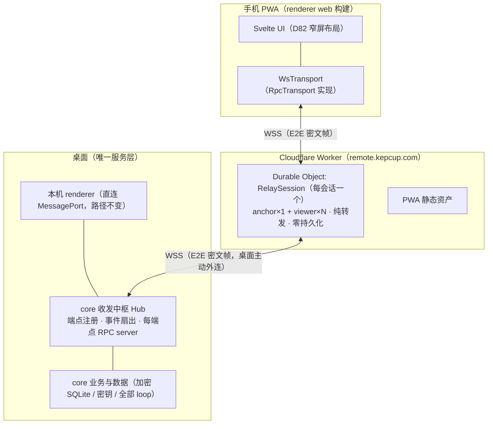

# 远程遥控（D96）

> 状态：**已定稿，未实施**（2026-10-23）。执行方案见 [todo/remote-control.md](../../todo/remote-control.md)。

## 0 摘要

移动端定位为**纯遥控器**：手机 PWA（现有 renderer 的 web 构建）只是「另一块屏幕 + 键盘」，所有执行、数据、密钥都在桌面，不存在同步层。桌面 core 即服务层，抽象**收发中枢（Hub）**：本机 UI 与远程端点是对等客户端，本机直连（MessagePort 不变），远程经公共服务中转（WebSocket）。中转是 Cloudflare Worker + Durable Object 的**哑转发**：多用户公共服务、零持久化、视为不可信、负载全程端到端加密。

曾经评估并放弃的方向（2026-10-23 讨论，记录在案避免重提）：手机内嵌 lite 运行时 + 多端数据同步 + 任务转交排队。放弃原因：多端同步复杂度高、数据不一致必然导致 LLM 响应预期分叉、只在帮用户省钱却拉低体验。本方案以「单一执行点」从构造上消除这些问题。

## 1 决策（D96）

1. **纯遥控器**：手机端为 PWA（浏览器打开 / 添加到主屏幕），无本地执行、无本地持久化业务数据、无同步层；原生壳（厂商推送、系统分享目标）后议。
2. **桌面 core 是唯一服务层**：所有 LLM 调用、工具执行、数据、密钥只在桌面。本机 UI 与远程端点**功能完全对等**，走同一份 RPC 目录（`APP_RPC_METHODS`），**不做只读门**；`PLATFORM_RPC_METHODS` 按宿主能力协商——物理上只能落在桌面的动作（弹通知、`shell.openExternal`、浏览器控制）照常在桌面执行，端点 UI 隐藏不适用项。
3. **收发中枢**：core 内抽象 Hub，端点（endpoint）= 本机 renderer + N 个远程端点，对等。中转连接关系：桌面 ↔ 中转是 **1:1 锚连接（anchor，桌面主动外连）**；每个遥控端 ↔ 中转各自 1:1；数据分发上，**事件帧广播**——core 推送的事件发给全部在线端点（本机 + 所有遥控端），**RPC 帧定向**（请求 → core，响应 → 发起端点），控制帧点对点。**信号区分 = 帧类型决定路由**，中转按帧类型执行三种转发策略，不理解内容。
4. **公共哑中转**：Cloudflare Worker（入口 + PWA 静态资产）+ Durable Object（每会话一个 `RelaySession`，仅内存态 + hibernation，无 durable 写）。多用户：会话 id 为不透明 ULID，每会话独立 DO 实例天然隔离；不存任何用户数据、不记录 IP；对全部负载 E2E 加密，中转不可信。
5. **配对即信任边界**：桌面出二维码（一次性配对码，5 分钟有效）→ 手机扫码 → 桌面确认（设备名）→ X25519 ECDH + HKDF 派生会话密钥（配对码作 PSK 认证；WebCrypto 不支持 X25519 时回退纯 HKDF-PSK）。**配对设备 ≡ 坐在本机前的用户**，拥有全部权限；支持多设备配对与撤销；远程敏感操作审计带 deviceId。
6. **secrets 卫生规则不变**：现有 RPC 层的敏感字段规则（secret / oauth / account 永不出现在可读快照与 `settings_change.Values`）对远程端点统一适用，远程不新增暴露面。
7. **域名与可替换性**：`remote.kepcup.com`（中转 + PWA 托管）。中转协议保持「连两条 WebSocket 转发帧」的傻瓜形态，Worker 源码随仓库（GPL）发布，设置里可改中转地址，自建中转可完整替代公共服务。
8. **P1 再做**：Web Push、手机附件上行（复用 D94 intake 幂等模式，D44 已注明「移动端分享另案」此处落位）、进度合流调优。**永不做**：手机本地执行任何 loop。

## 2 目标与非目标

### 2.1 目标

- 手机上**完整操作** KepCup：浏览 / 发起对话（回环在桌面跑）、远程批准 / 拒绝审批卡、任务分派与进度查看、工作台、设置读写。
- 多个遥控器同时在线，事件实时广播到每个端点。
- 断线零成本恢复：重连后走 renderer 现有启动自举（拉列表 + 订阅事件），**没有补同步、没有离线队列**；桌面离线时手机显示离线态（纯遥控器的既定取舍）。
- 桌面掉线中转不掉数据：中转无数据可掉；桌面重连后遥控端自举刷新。

### 2.2 非目标（P0 不做）

- 手机本地执行任何 loop / 工具；消息多端同步；中转侧存储 / 搜索 / 处理任何用户数据。
- 推送通知（P1，Web Push，需另行配置 VAPID key）。
- 原生壳、厂商推送通道、手机系统分享目标（P2 再议）。
- 手机传感器（麦克风 / 摄像头）上行——P2 随原生壳评估。

## 3 产品形态

### 3.1 入口与配对

- 设置页新增「远程遥控」分区：总开关（默认关）、自定义中转地址（默认 `wss://remote.kepcup.com`）、「连接手机」按钮、已配对设备管理（名称、指纹、最后在线、撤销）。
- 托盘菜单：「远程遥控」快捷开关 + 「连接手机…」（弹出二维码小窗）；连接后托盘显示「手机已连接 (n)」。
- 二维码内容：`https://remote.kepcup.app/#pair=<relayUrl>,<sessionId>,<pairingSecret>`（URL 安全 base64）。手机扫码即打开 PWA 并自动进入配对确认。
- 桌面确认卡显示手机侧上报的设备名（手机可编辑，如「李的 iPhone」）+ 浏览器 / 型号信息，用户点「允许」完成配对。

### 3.2 手机端

- PWA：remote.kepcup.com 打开 →「添加到主屏幕」。导航直接用 D82 窄屏布局（对话 / 通讯录 / 扩展 / 我 + 详情层），补安全区（刘海 / 手势条）与横滑返回的适配。
- 与桌面完全相同的界面与能力；桌面专属项（如本地文件选择对话框）按 capabilities 显示为不可用，不隐藏入口造成「功能消失」错觉。
- 远程审批卡与本地同款，加「远程」徽标；审批动作在审计里记 `remote:{deviceId}`。
- 连接状态页：桌面离线 / 中转不可达时显示明确状态与重试，不做任何本地缓存式浏览。

## 4 架构

### 4.1 总览



### 4.2 收发中枢（core）

- 端点注册表：`local`（现有本机 renderer，经 MessagePort 的 RPC server 不动）+ `remote:{deviceId}`（每个在线遥控端一个）。远程端点各自实例化一个 `createRpcServer`，**绑定同一份 handlers**（`packages/core/src/rpc/bindings.ts`），能力对等由此免费获得。
- 事件扇出：core → renderer 的现有事件总线增加订阅者（Hub）。本地端点的推送路径零改动；Hub 将事件编码为 `event` 帧 → 中转 → 广播。高频事件（`run.progress` 等）在 Hub 侧合流（同类事件 ≤10Hz，保留最新）。
- RPC：遥控端的请求帧定向转发到 core；响应帧携带目标 `did`，由 DO 定向投回发起端。birpc 的 requestId 即帧内 `rid`。
- 并发与一致性：core 单线程串行处理所有端点请求，多端点并发写 = 到达序生效（与今天同一量级的一致性语义），事件广播保证其余端点随后收敛到最新状态。

### 4.3 中转服务（Cloudflare Worker + DO）

- **Worker 入口**：WSS 升级，按 URL 里的 sessionId 路由到 `RelaySession` DO；同时托管 PWA 静态资产（renderer web 构建产物，长缓存 + hash 文件名）。
- **RelaySession DO**：维护 anchor socket（≤1）与 viewer socket（≤5）及 `did → socket` 路由表。转发规则（只看 envelope 明文头，不看密文）：

| 帧类型 | 来源 | DO 动作 |
| --- | --- | --- |
| `event` | anchor | 广播给全部 viewers |
| `rpc` / `pairing` / `hello` | viewer | 转发给 anchor |
| `rpc`（带目标 did） | anchor | 定向给该 viewer |
| `kick` / `error` / `ratelimit` | anchor 或 DO 自身 | 定向给目标 viewer |
| `ping` | 任一 | 应用层回 pong，维持 hibernation 活性 |

- **生命周期**：anchor 断开 → viewers 收 `anchor_offline` 信号；DO 保活 TTL（默认 10 分钟）等待桌面重连；全空即逐出。DO 无 durable 写，重建零成本。
- **多用户与滥用防护**（免费套餐全站限速规则已被 registry 占用，限流全部在 DO 内实现）：每连接令牌桶（持续 30 msg/s、突发 60）；单帧 ≤ 512KB（逻辑消息分片重组见 §4.5）；每会话 viewers ≤ 5；每 IP 并发会话数上限；不记录 IP、不落任何日志存储。
- **成员资格校验在中转之外**：DO 只防会话 id 枚举（ULID 128bit 不可猜）与滥用；`join` 后的合法性由 anchor（core）在 E2E 帧内校验（token challenge），失败由 anchor 发 `kick`。中转永远接触不到密钥与明文。

### 4.4 连接与配对

```mermaid
sequenceDiagram
  participant P as 手机 PWA
  participant DO as RelaySession(DO)
  participant A as 桌面 core(anchor)
  A->>DO: 开关开启即外连 WSS(join anchor)
  P->>A: 设置「连接手机」→ 生成配对码 → 二维码
  P->>DO: 扫码打开 PWA,join(viewer)
  P->>A: pairing 帧(pubkey + HMAC(配对码, transcript))
  A-->>P: 桌面确认卡:设备名 → 允许 → pubkey
  A->>P: ECDH+HKDF → 会话密钥;登记设备;下发 session token
  Note over P,A: 之后每次重连:join(did, token) → E2E challenge → 恢复
```

- anchor 常驻外连：开关开启时连接中转，断线指数退避重连（上限 5 分钟），应用层心跳 30s。
- 配对码：16 字节随机，一次性、5 分钟过期，仅存在于桌面内存；二维码即带出（QR 视为带外信道）。
- 密钥派生：X25519 ECDH（双方临时密钥对）+ HKDF-SHA256（输入：共享秘密 ∥ HMAC(配对码, transcript)）→ 双向会话密钥；WebCrypto 无 X25519 的环境回退 HKDF(配对码) 直派（无 PFS，安全降级注明）。
- 重连凭证：`deviceId + session token`（随机 32B，PWA storage 保存）；桌面只存 token 哈希与密钥指纹。重连时 anchor 发 E2E challenge（HMAC 会话密钥）防 token 冒用。
- 撤销：设备管理删除 → anchor 发 `kick` → 删除本地密钥与 token 哈希 + 审计；中转侧无需任何操作。
- 桌面重启：`remote_devices` 与密钥在加密库中持久，重连自动恢复；PWA 侧 token 不变，无需重新配对。

### 4.5 帧协议（信号区分）

- envelope（明文路由头，最小化）：`{ v: 1, sid, did?, type, rid?, n, frag? }`；`type ∈ pairing | hello | rpc | event | kick | ping | error`。
- 数据帧 payload 一律 AES-256-GCM 密文（密钥按方向区分，AAD = envelope 去密文）。
- 防重放：每方向单调计数器 `n`，接收侧滑动窗口（如 64）拒绝回退 / 重复。
- 分片：逻辑消息 > 128KB 时按 `frag` 分片、端侧重组，单逻辑消息上限 8MB（P0 的 RPC 负载——文本消息、审批、设置——远小于此；大附件读取沿用现有分页参数）。
- 版本协商：`v` 不识别即断开连接并报错，不做静默降级。

## 5 数据与契约

### 5.1 shared（`packages/shared/src/domain/remote.ts` 新增）

- `relayEndpointSchema`（中转地址配置）、`pairedDeviceSchema`（deviceId、name、keyFingerprint、createdAt、lastSeenAt、revokedAt）、`pairingOfferSchema`、`remoteAnchorStateSchema`（中转连接状态机：off / connecting / online / error）。
- 帧与 handshake 的 zod schema（envelope 各类型 + payload 明文结构，供两端 codec 共用）。
- `host-capabilities.ts` 增远程端点能力集（desktop-only 项的可见性判定，renderer 据此裁剪 UI）。

### 5.2 RPC 与事件（`packages/shared/src/rpc/`）

- `methods.ts` 增 `remote.*`：`remote.status` / `remote.createPairing` / `remote.confirmPairing` / `remote.revokeDevice` / `remote.devices` / `remote.config.{get,set}`（开关与中转地址）。全部带 zod 输入输出，走 `APP_RPC_METHODS` 登记。
- `events.ts` 增：`remote.anchorState`（中转连接状态变化，本机 UI 托盘 / 状态页共用）、`remote.deviceChanged`（上线 / 下线 / 撤销 / 新配对）。

### 5.3 存储（core）

- main.db 迁移 `0048_remote_devices.sql`：`remote_devices` 表（deviceId 主键、name、keyFingerprint、tokenHash、createdAt、lastSeenAt、revokedAt）。
- 会话密钥与 token 明文不落明文库：密钥材料入 `secrets` 表（键 `remote:{deviceId}`，沿用 AES-256-GCM 加密），配对码仅内存。
- 审计：远程端点发起的审批、设置写入、任务取消等动作，审计记录带 `remote:{deviceId}` 来源标记（沿现有审计链路加来源字段）。

### 5.4 设置目录（唯一事实来源，按 AGENTS.md 流程）

- `items.ts` 新增「远程遥控」组：开关、中转地址两项为简单全局标量 → `store: { kind: 'settings', generic: true }` + `card: 'field-editor'`（零 core 改动的路径）；设备管理为复杂条目 → 贡献组 + 专用卡片（`contributions/` 注册、渲染层 `cards/index.ts` 加条、`SettingCardEmbed.svelte` 加分支）、设置页 `data-settings-anchor` 落锚。
- 验收即跑设置目录定向测试四件套（见 §8）。

### 5.5 PWA 构建

- renderer 增加 web 构建目标（同一份 Svelte 源码；vite 多 target 或独立 `apps/remote` 引用 renderer 源）。transport 用 `WsTransport` 替换 MessagePort 版（实现 `RpcTransport` 三方法接口）。
- manifest + 图标 + 安装引导；safe-area（`env(safe-area-inset-*)`）与横滑返回（`popstate` / 视图栈）适配；service worker P0 仅做静态缓存壳（推送 SW P1）。
- 构建产物部署为 Worker 静态资产；自建中转用户可自行托管同一构建（配对 URL 里的 relay 参数指向自建地址）。

## 6 核心实现

| 模块 | 位置 | 职责 |
| --- | --- | --- |
| Hub | `packages/core/src/remote/hub.ts` | 端点注册表、每端点 RPC server 实例化（复用 `createRpcServer` + `bindings`）、事件订阅与扇出、高频事件合流 |
| 中转客户端 | `packages/core/src/remote/relay-client.ts` | WSS 主动外连（Node 22 全局 WebSocket）、重连退避、心跳、帧收发 |
| 配对管理 | `packages/core/src/remote/pairing.ts` | 配对码生命周期、确认流程、设备登记 / 撤销、ECDH 握手 |
| E2E 编解码 | `packages/core/src/remote/codec.ts` | 帧加解密（AES-256-GCM）、防重放窗口、分片重组；shared schema 驱动，两端共用 |
| 审计 | `packages/core/src/remote/audit.ts` | 远程操作来源标记注入现有审计链路 |
| 中转 | `infra/cloudflare/relay/` | Worker（WSS 入口 + 静态资产）+ `RelaySession` DO（路由表、广播 / 定向、限流、TTL） |
| 桌面入口 | `apps/desktop/src/main/` | 托盘状态与菜单、二维码小窗、开关项；main 保持薄，只做窗口与托盘 |
| 手机端 | renderer web 构建 + `WsTransport` | UI 复用、capabilities 裁剪、安全区、安装引导 |

## 7 安全与隐私

- **威胁模型**：中转被攻破或运营者恶意 → 只见密文与元数据（sid、did、帧大小与时序），无内容、无身份（无账号体系、无 IP 日志）；二维码被截获 → 5 分钟一次性 + 桌面确认卡拦截；手机失窃 → 设备撤销即时生效；帧重放 / 篡改 → 计数器 + AEAD；协议降级 → 版本不匹配即断开。
- **信任边界**：配对设备等同本机用户全权（这是「功能完整对等」的必然语义），配对与撤销 UI 必须明示。secrets 卫生规则（§1.6）统一适用于所有端点，远程不放大敏感面。
- **公共服务披露**（话术沿 [todo/hosted-auth-gateway.md](../../todo/hosted-auth-gateway.md) 的中转立场）：中转仅转发加密帧，不保存任何用户数据、不记录 IP；帧格式与 Worker 源码公开（GPL），可自建替代。
- **成本与配额**：免费套餐起步（DO SQLite 型免费可用；WebSocket 每消息计一次请求，免费 10 万次 / 天）。公共服务多用户增长后按需升 Workers Paid（$5 / 月，含 1000 万次 / 天）——升级只能由用户在控制台操作（见 `infra/cloudflare/README.md` §4.3）。

## 8 测试

- **单元（core / shared）**：codec round-trip 与防重放（回退 / 重放 / 篡改用例）、配对状态机（过期 / 一次性 / 拒绝 / 撤销）、Hub 路由（event 广播 vs rpc 定向 vs 合流）。先 `pnpm --filter @kepcup/shared build` 再跑 core。
- **Worker**：`vitest-pool-workers`（miniflare）跑 DO——多会话隔离（互不可路由）、限流（令牌桶超限）、anchor 断开重连、viewer 上限与 kick。
- **契约 / 设置目录**：`settings-catalog.test.ts`、`settings-item-writes.test.ts`、`settings-adapters-coverage.test.ts`、`card-components.test.ts` 四件套（AGENTS.md 清单）。
- **端到端**：miniflare 起中转 + 双假端点（anchor / viewer WS 客户端）跑配对 → RPC → 事件广播全链路断言；renderer web 构建用 Playwright 冒烟（打开、配对态、对话收发）。
- 收口跑一次全量 `pnpm test`（阶段收口例外，见 AGENTS.md）。

## 9 分期

- **P0（本期）**：shared 契约 → core Hub / codec / pairing / relay-client → Worker + DO → 桌面入口（设置 / 托盘 / 二维码 / 设备管理）→ PWA web 构建 → 加固与测试 → 部署 `remote.kepcup.com`。验收：两台真机（手机浏览器 + 桌面）完成配对，手机完整操作（对话、远程审批、任务、工作台、设置读写），断线重连自举正确，撤销即时生效。
- **P1**：附件上行（手机相册 → 对话，复用 D94 intake 幂等模式）、Web Push（VAPID）、合流参数调优。
- **P2（再议）**：原生壳（厂商推送、系统分享目标）、自建中转一键部署脚本。

## 10 与既有决策的关系

- **D82（33 窄屏布局）**：导航模型与组件复用的直接前提，本方案是它预告的「未来移动端」的第一形态。
- **D83（34 供应商）**：供应商是模型 / 检索代理（境内云 NestJS+PG，合规原因不走 Cloudflare、正文不持久化）；本中转是不碰内容的传输层，两者目的与合规面不同，Cloudflare 承担中转不与 D83 的「Cloudflare 仅承担 OAuth」结论冲突（该表述的适用范围是供应商服务）。
- **D94（44 分享接收）**：其「移动端分享另案」在 P1 附件上行中落位（手机 → 桌面 intake 复用同一幂等模式）。
- **D95 文件预览**：远程端点查看文件卡片时同样只走 `files.preview` 受限读取路径，预览渲染能力随 web 构建自然继承，桌面专属的「系统程序打开」在手机端显示为不可用。
