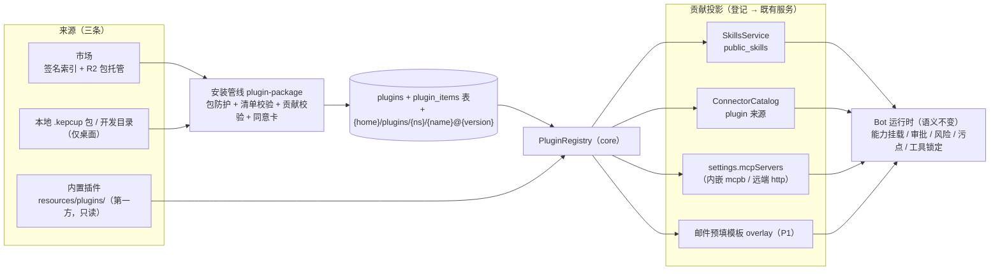

# 51 插件系统（Plugin System）

> 状态：**已确认（2026-10-26：§14 的 Q1–Q9 与开放问题均按推荐；同日对照代码审查修订），按 §13 分期实施**；执行方案见 [todo/plugin-system/](../../todo/plugin-system/README.md)；决策 D104。上游：[29-connected-apps.md](29-connected-apps.md)（D73 连接应用 / D74 开放平台基座，§16 扩展中心）、[35-mail-channel.md](35-mail-channel.md)（D84）、[38-conversational-settings.md](38-conversational-settings.md)（D89 设置目录）、[40-capability-mounting.md](40-capability-mounting.md)（D91 能力挂载）、[28-external-agents-acp.md](28-external-agents-acp.md)（D72 外部智能体）、[22-file-skill-routing.md](22-file-skill-routing.md)（D63 技能升级阶梯）。应用处于早期开发阶段：**本方案不做向后兼容**，存量内容按 §12 一次性改造。审查中对原稿的修正见文末「审查修订记录」；§14 的决策均已按推荐确认。
>
> **D105 现状注（2026-10-29）**：本文 §0–§14 描述 D104 第一期模型。其后 **D105 插件平台迭代**（[todo/plugin-platform/](../../todo/plugin-platform/README.md)）把插件升级为「应用一切能力的载体」——能力类型注册表、实例与插件配置、以插件为唯一注入单位、邮件插件化、安装引导。**现状事实见 §15；与 §0–§14 冲突处以 §15 为准**（各处历史叙述保留为决策记录）。

## 0. 背景与问题

扩展中心（设计 29 §16）今天有五组：Skills / 连接 / MCP / 邮件 / 本机协作（另有设置页的「智能体」目录）。它们的**内容来源各自为政**：

| 组 | 内容从哪来 | 装法 | 代码锚点 |
|---|---|---|---|
| Skills | 随应用打包的 `resources/preset-skills/`（`catalog.json` + 9 个技能） | 一键安装为公共技能（`skills.presets.install`）；模型也可经 `install_skill(preset_id)` 请求（D63） | `skills/presets.ts`（`SkillPresetsService`） |
| 连接 | 打包 `resources/connectors/catalog.json`（9 家）+ 签名远端目录 + 本机自建（设计 29 §17），三者在 `ConnectorCatalog` 合并 | 目录卡片 + OAuth | `apps/catalog.ts`、`apps/directory-sync.ts`、`apps/directory-merge.ts`、`apps/local-connectors.ts` |
| MCP | 用户手填（stdio / http / sse）或 `.mcpb` 文件；`mcp-presets/` 只是未接线的空壳 | 表单 / 文件选择器 | `mcp/service.ts`、`apps/mcpb/` |
| 邮件 | 代码里写死的 `MAIL_PROVIDER_PRESETS`（按 `MailProvider` 枚举索引的类型化表） | 表单（预设下拉） | `shared/domain/mail.ts` |
| 本机协作（InkCop） | 代码内置 | 开关 | — |
| 智能体（设置页，非扩展中心） | `AGENT_CATALOG`（shared，条目绑定 core 的 Provider 模块） | 启用 = 按需安装 + 官方登录 | `shared/domain/agent-catalog.ts`、`agent/external/` |

缺的是三样东西：**一个统一的「包」单位**（一个第三方可以一次交付「技能 + 连接器 + MCP 服务器」的组合）、**一条统一的安装管线**（校验 → 落盘 → 登记 → 投影，而不是每类各写一遍）、**一个市场**（服务端目录 + 下载安装，或本地上传包）。本方案补的就是这层壳：扩展以**插件（plugin）**的形式补充——要么从服务端 marketplace 下载安装，要么本地上传扩展包，用法对齐 VS Code extensions。

## 1. 业界调研

| 系统 | 包单位 | 清单 | 内容形态 | 分发 | 信任 |
|---|---|---|---|---|---|
| **VS Code** | `.vsix`（zip） | `package.json`：id/publisher/version、`engines.vscode`、`activationEvents`、`contributes`（贡献点） | **进程内代码**（extension host 里 `activate()`） | 官方 Marketplace（`vsce` 发布，认证迁往 Microsoft Entra ID，全局 PAT 2026-12-01 退役；支持按平台分发包）+ 本地 VSIX（"Install from VSIX" / `code --install-extension`） | 发布者账号（已验证发布者 = 域名 TXT 验证）+ Marketplace 审核 + 客户端验签 |
| **Open VSX** | 同 VSIX | 同上 | 同上 | Eclipse 基金会运营的开放市场：REST API + 静态包托管，VSCodium / Gitpod 等 fork 消费 | 发布者令牌；客户端换 endpoint 即整体切换市场 |
| **Obsidian** | 文件夹（`main.js` + `manifest.json` + `styles.css`） | `manifest.json`：`id/name/version/minAppVersion/description/author/isDesktopOnly` | `main.js`（任意 JS，直跑在 App 内） | GitHub Release（tag = manifest 版本）+ Obsidian Community 目录（账号关联 GitHub 证明仓库归属，自动审查后人工发布）；手动安装 = 把文件拷进 vault 的 `.obsidian/plugins/` | 目录审核，无包签名 |
| **Claude Code / Cursor 插件** | 目录（Claude：`.claude-plugin/plugin.json`；Cursor：`.cursor-plugin/plugin.json`） | 轻清单：name / version / description / author 等 + 约定目录（`skills/`、`.mcp.json` 等） | **技能 + MCP 配置的组合分发**（Claude 另含 agents / hooks，hooks 与 hooks 模块是在用户权限下执行的命令 / JS） | marketplace = 带 `.claude-plugin/marketplace.json` 的仓库或目录（「目录而非托管商店」），装到 `cache/{marketplace}/{plugin}/{version}`，`installed_plugins.json` 登记（user / project / local 作用域） | 靠来源仓库，无签名；官方明确「插件能以你的权限运行代码」 |
| **MCPB**（本仓已支持） | `.mcpb`（zip） | `manifest.json` v0.1–0.3 | 一个 MCP server（node / python / binary / uv，运行时受管） | 手动分发 / 内嵌 | sha256 绑定 + 解包防护 |

**可借鉴的**：VS Code 的**贡献点模型**——清单声明「我贡献什么」，宿主按类别各归其位；**包 = 分发单位**、`engines` 兼容声明、**安装 = 校验 → 解到扩展目录 → 登记**（登记是薄层）。Open VSX 证明市场可以只是「索引 + 静态包托管」。Claude Code / Cursor 插件与本方案**最同向**：声明式、轻清单、技能 + MCP 的组合包，安装 = 缓存目录 + 登记表，marketplace = 索引文件。Obsidian 证明极简清单 + 社区审核就能养出生态。

**不采用的**：VS Code 的**进程内代码执行**（extension host + `activate()` + 版本化宿主 API）与 Claude Code 的 hooks / 代码模块。代价是三项：任意代码进宿主进程的攻击面、宿主 API 的兼容承诺（与早期快速迭代冲突）、与 D74「不发明协议」底座的正面冲突——KepCup 的每一类扩展**已经是数据 + 标准协议**（工具 = MCP、界面 = MCP Apps、用法 = Agent Skills、元数据 = `server.json`、本地包 = MCPB），动态行为都能以 MCP server 形态进入且已被监管（`McpService` 懒连接 / 重连、`env/` 运行时管理、沙箱、审批、污点）。Obsidian 的「任意 JS 直跑」同理不做。

**在同类方案之上补的**：签名索引（Ed25519，客户端验签 + 防回滚 + 撤销名单）、分级信任（D74）、统一同意卡（权限从贡献推导而非采信自述）、MCPB 的 sha256 绑定与解包防护。

**结论**：插件系统 = 在 D74 基座之上补「**包格式 + 安装管线 + 市场**」，**不新增执行模型**。

## 2. 总体架构



核心决定（D104）：

1. **插件 = 声明式贡献包，不是宿主代码。** 一个插件是一个 zip 包（`*.kepcup`），内容是各类别的**贡献（contributions）**：技能文件夹、连接器元数据（`server.json` + `_meta`）、内嵌 MCPB、远端 https MCP、邮件预填模板。**插件不含在宿主进程里执行的代码；需要代码的能力一律以 MCP server 形态进入**（远端 https 或包内 MCPB，运行时受 `env/` 管理与既有监管约束）。没有 activation events、没有 extension host、没有宿主扩展 API——声明式贡献天然懒激活（技能只是提示词里的名字行、MCP 服务器本就懒连接、连接器连上才算数）。被否决的替代方案见 §1；将来若确有宿主级需求，以「受控 MCP 桥 + 权限声明」演进，不开进程内 API。
2. **三类来源、一套模型。** 内置（builtin：随应用分发的第一方插件，**只读、不入 `plugins` 表**，只含技能与连接器，§12）、市场（marketplace：签名索引下载）、本地（`.kepcup` 上传或开发目录安装）。市场与本地过同一条「校验 → 同意 → 解包到 `{home}/plugins/` → 登记 → 投影」管线；内置插件每次启动从应用资源只读加载，过同一份 schema，不走安装 / 卸载 / 启停。
3. **市场 = 签名索引 + 静态包托管**（复用 `directory-sync` 的验签 / 防回滚 / 缓存机制，§6.1）：Ed25519 在 CI 离线签名的索引（条目含 sha256、engines、贡献摘要），客户端每日拉取、按需下载、sha256 校验、含撤销名单。endpoint 可配置，**自托管 endpoint 必须同时登记自己的公钥，且条目最高 `community` 级**（§6.1）。不引入账号体系、不做站内发布流（提交 / 审核属 developer-portal，P3 另行设计）。
4. **信任分级沿用 D74**：`builtin / verified / community / developer`。分级由**来源**决定（索引里带、本地恒 `developer`、内置恒 `builtin`），包内自标一律无效。落到各类别：连接器用 `ConnectorTier` 原值；MCP server 的 `tier` 字段只有 `developer` 一档（设计 29 §11.3），所以**本地与 community 的 MCP 贡献一律标 `developer`**（全部工具逐次确认，fail-closed），verified 不标（W5 默认）。
5. **投影而非重造。** `PluginRegistry` 只做「装 / 卸 / 启停 + 登记」；每类贡献由该类别既有服务以「来源投影」接入（`ConnectorCatalog` 加 plugin 来源、`SkillsService` 加 plugin 来源标记、内嵌 MCPB 复用 `McpbInstaller`、邮件模板做运行时 overlay）。**运行时语义一律不变**：审批、风险分级、工具锁定、污点、能力挂载（D91：插件贡献的连接 / MCP 自动成为 `app:{slug}` / `mcp:{serverId}` 能力）照旧。
6. **两种投影语义：落地型与目录型。** 它决定了内置插件（逐条可选）与「确认一次 = 装全部」能否同时成立：

| 贡献 | 语义 | 安装（或加载）插件后发生什么 |
|---|---|---|
| skills（市场 / 本地插件） | **落地型** | 随插件装为公共技能，对所有 Bot 可见（同意卡明示） |
| skills（内置插件） | **目录型** | 只进预置目录，逐条安装，行为与今天的预置技能完全一致（`<recommended_skills>` 段、`install_skill(preset_id)`、`skills.presets.*` 不变，后端改读插件贡献） |
| mcp（mcpb / http） | 落地型 | 登记 server（`enabled` 随插件启停）；敏感 `user_config` 在安装时由用户填 |
| connectors | 目录型 | 条目进目录；**连接（OAuth）仍是用户逐个操作**，插件安装不代连 |
| mail | 目录型 | 模板进「添加邮箱」下拉，不创建账号 |

## 3. 插件包格式

- 文件：`*.kepcup`（zip）；清单：包根 `plugin.json`；`README.md`（详情页展示）、`icon.png|svg`（本地 ≤256KB；市场索引内联版 ≤64KB）。**市场发布必须有图标**，缺失时 `validate` 报 error；运行期对历史 / 手工索引仍回落宿主默认图标。
- 清单 schema（落在 `packages/shared/src/domain/plugin-manifest.ts`，zod；示意）：

```jsonc
{
  "format_version": 1,                        // 客户端不认更高版本：拒绝并提示升级 KepCup
  "id": "io.github.alice/doc-tools",          // 规则同 connectorNameSchema（反向域名/名字，≤200）
  "name": "文档工具集",                         // 展示名（经 sanitizeDisplayText 清洗）
  "version": "1.2.0",                          // semver
  "description": "……",
  "author": { "name": "Alice", "url": "https://…" },
  "homepage": "https://…",
  "engines": { "kepcup": ">=0.4.0" },          // 对 core appVersion 的 semver 约束
  "platforms": ["darwin", "win32", "linux"],   // 缺省 = 全平台
  "contributions": {                           // 类别由贡献推导，清单不另行声明
    "skills":     [ { "dir": "skills/docx" } ],                      // 每个 dir = 标准 SKILL.md 文件夹
    "connectors": [ { "file": "connectors/notion/server.json" } ],   // server.json + _meta（tier / releaseGate 无效）
    "mcp":        [ { "id": "dbtools", "kind": "mcpb", "file": "mcp/dbtools.mcpb", "description": "…" },
                    { "id": "docs", "kind": "http", "url": "https://mcp.example.com/mcp", "description": "…" } ],
    "mail":       [ { "id": "fastmail", "label": "Fastmail",
                      "imap": { "host": "imap.fastmail.com", "port": 993, "secure": "ssl" },
                      "smtp": { "host": "smtp.fastmail.com", "port": 465, "secure": "ssl" },
                      "defaultMode": "auto", "helpUrl": "https://…" } ]   // 字段同 MailProviderPreset
  }
}
```

约束与规则：

- **id / 命名空间**：复用 Registry 命名空间规则；`com.kepcup/*` 与 `local.kepcup/*`（本机连接保留）为保留，市场与本地安装拒绝冒用（近似仿冒进人工队列，沿用设计 29 目录的保留名单思路）。命名空间归属证明属 P3 门户；此前市场由 KepCup 策展。
- **文件引用**：`dir` / `file` 一律包内相对 POSIX 路径（同 `safeEntryPath` 规则：无 `..` / 绝对路径 / 反斜杠 / 冒号），**解包后 realpath 必须仍在插件目录内、不得有符号链接**（`mcp-presets` README 里「接线前必须补齐」的防护清单——realpath 包含、sha256 绑定、http 主机校验、清单版本上限——在此一并落实）。
- **技能**：每个 `dir` 过 `parse.ts` + `scan.ts`；技能名取 SKILL.md frontmatter。展示字段（`displayName / summary / icon / section / tryIt / vendored`，即现有 `preset-skills/catalog.json` 的字段）仅内置插件使用，其他来源可省，回落到 SKILL.md 的 name / description。
- **MCP 本地贡献只允许内嵌 MCPB**：清单里不允许裸 stdio `command`（那等于让 manifest 指挥宿主执行任意本机命令）；本地执行自包含在 `.mcpb` 里，运行时（node / python / uv）由 `env/` 管理器提供。每条 mcp 贡献有包内稳定 `id`（`[a-z0-9-]{1,32}`），server id = `plg_` + `sha256("{pluginId}#{id}")` 前 12 位十六进制——满足 `MCP_SERVER_ID_PATTERN`，**跨版本更新保持不变**，所以 `mcp:{serverId}` 能力、逐工具策略与 Bot 勾选不因更新丢失。`description` 进系统提示的 `<capabilities>` 目录行（D91，经 `oneLine` 清洗、≤200 字），因此**仅 verified 及以上才采用清单文案，其余用缺省文案**。
- **远端 http MCP**：必须 https、无用户信息 / 非 IP / 非 `localhost` 与内网后缀——复用 `directory-merge.ts` 的 `isSafeDirectoryRemoteUrl`（不用 `isSafeSkillSourceUrl`：那是技能 git 地址的判定，拒绝端口 / 查询串，不适合 MCP 端点）；**需要 OAuth 的远端一律做成 `connectors` 贡献**（走 D73 授权引擎），`mcp.http` 不带认证（`auth:'none'`）。
- **连接器贡献**：文件就是开放平台格式（`connectorCatalogEntrySchema`：`server.json` 子集 + `_meta["app.kepcup/connector"]`）；`_meta` 里 `tier` 与 `releaseGate` 无效（来源定级 / 改写）；`icon` 取同目录内文件（不读全局 `icons/`）；slug 受 `CONNECTOR_SLUG_PATTERN` 约束，name / slug 不得与现有生效目录冲突（§4）。
- **邮件模板**：字段与 `MailProviderPreset` 对齐（`secure: 'ssl' | 'starttls'`、`defaultMode`、`defaultPollSec`、`minPollSec`、`helpUrl`）；主机做静态域名检查，运行期仍由 `mail/hosts.ts` 的解析钉死（防 DNS 重绑定）兜底。
- **体积与数量上限**：沿用 `mcpb/zip.ts` 的硬上限——文件 512MB、解包 500MB、条目 20,000、单条目 200MB（所以内嵌 `.mcpb` ≤ 200MB，比独立 `.mcpb` 更紧）；`plugin.json` ≤ 64KB；不支持 ZIP64 / 加密。
- **兼容性**：`platforms` + `engines.kepcup` 在安装时校验；core 的 `appVersion` 缺省为 `'0.0.0'`（开发 / 测试），此时**跳过 engines 校验**；内嵌 MCPB 的 `compatibility.runtimes` 透传给 `McpbInstaller`。
- **与 MCPB 的关系**：MCPB 仍是「单个 MCP 服务器的标准包」，独立安装 `.mcpb` 的入口**保留不变**（`source: {kind:'mcpb'}`）。插件内嵌是多一层包装，登记为 `source: {kind:'plugin', pluginId, version, key, mcpb:{name, version, sha256}}`。这要求 `McpbInstaller` 小幅重构：把「校验 + 解包 + 渲染启动命令」与「登记 settings」拆开；`uninstall` / `afterServerRemoved` / `#releasePackage` 里写死的 `source.kind === 'mcpb'` 改为按 `name@version` 统计两种来源的引用。不把 MCPB 吸收成私有格式——那是标准，插件是 KepCup 自己的「组合分发单位」。
- **无依赖、无插件包（extension pack）**：首期不做插件间依赖与「合集」类型；见 §14。

## 4. 贡献类别与投影

| 贡献 | 投影到哪 | Bot 怎么消费（全部既有路径） |
|---|---|---|
| **skills** | `SkillsService.installPublic`，`skill_library.source_url = plugin://{pluginId}/{skillName}`（对齐现有 `preset://`，支持内容哈希原地更新）。归属**记在 `plugin_items` 账本**，不靠 `source_url` 反推（库按 `name@hash` 去重，同字节内容的库行不会因第二个来源改写 `source_url`） | `<skills>` 提示词段 + 沙箱只读目录；内置插件的技能走目录型（§2 第 6 条） |
| **connectors** | `ConnectorCatalog` 新增 plugin 来源：与本机连接同位，**在发行门禁之后追加**（不经 `filterReleasedConnectors`），与已有条目（打包 / 远端 / 本机 / 先装插件）的 slug 或 name 冲突时让位；`ConnectorOrigin` 增加 `plugin`（`apps.catalog.list` 的 `origin`）；图标读插件目录而非 `icons/`；端点按目录来源条目处理（连接前重新校验为公网 https，**永不给回环例外**）；`releaseGate` 改写为 `plugin`。内置插件的连接器就是 bundled 快照来源本身（`originOf` 仍为 `bundled`，`directory-merge` 的锚点语义不变） | 目录卡 → OAuth 连接 → `app_{slug}_*` 工具、能力 `app:{slug}`、审批 / 锁定 / 污点照旧；本地来源 = `developer` 级（逐次确认、无持续授权、`ui:false`，设计 29 §17.3a） |
| **mcp（mcpb）** | `McpbInstaller` 解包到 `toolchains/mcpb/{name}@{version}/`，登记 `settings.mcpServers`（`source.kind='plugin'`，id 见 §3，`tier` 见 §2 第 4 条） | `mcp_{serverId}_*` 工具、能力 `mcp:{serverId}`、`user_config` 敏感值入 secrets 照旧 |
| **mcp（http）** | 登记一条 `streamable-http` 自定义 server（`auth:'none'`，`enabled` 随插件启停）。`mcp.attachHttpFetch` 的守卫谓词需扩展：今天只对本机连接换用 `createGuardedMcpFetch`，plugin 来源的 http server 与 plugin 连接器**必须同样走守卫**（连接时校验解析地址、仅跟随同源重定向） | 同上；只读 / 写按 D65 风险分级 |
| **mail**（P1） | 「添加邮箱」表单的预填模板 overlay（不落库）。选中模板创建的账号仍是 `provider:'custom'` + 完整端点（`MailProvider` 是 zod 枚举、`Record<MailProvider,…>` 穷尽、DB `provider` 列存的就是它，不放开）；模板的 `minPollSec` / `defaultMode` 只做预填，全局 60 秒下限仍是硬限 | 绑定 / 收发 / 审批照旧；账号不引用模板，卸载插件不影响已建账号 |
| **UI** | 无独立贡献：插件的 MCP server 以 MCP Apps（`ui://`）提供（`developer` 级无界面卡） | 对话内 `mcp_app` 卡片，设计 29 §11.6 语义不变 |

**首期不做、预留**：

- **智能体（`agents`）**：`AgentCatalogEntry` 绑定 core 的 Provider 模块（`provider` 字段）、构建期生成的 npx 锁文件（`scripts/generate-agent-lockfiles.mjs`）与发行门禁；其 `distribution`（npx / 二进制归档 / 系统 CLI）是**宿主执行第三方代码的通道**，不属于「唯一本地执行 = 内嵌 MCPB」。因此 `AGENT_CATALOG` 保留在代码里，智能体贡献待有真实需求再评估（Q3）。
- settings 贡献 / 本机协作：P2+ 评估（settings 需要目录支持运行时条目，见 §14）；InkCop 通道保持内置。

明确**不是**插件类别的：Bot 组件（widgets，Bot 自制交付物，设计 32）、模型供应商（涉及密钥与计费，设计 16 / 34）、沙箱后端（平台能力）。Bot 模板（设计 48）是「资产导出」而非可挂载贡献，后续可评估作为市场内容类型（§14）。

**冲突规则**：安装时先对**当前生效状态**预检，冲突即整体拒绝并报 `PLUGIN_CONFLICT`（指明冲突项与既有来源），不自动接管。键与范围：公共技能名（**任何来源**的同名公共技能；Bot 私有同名技能是遮蔽而非冲突）；连接器 slug / name（对照打包、远端、本机与其他插件）；MCPB 的 `name@version` 槽位（同槽不同 sha256 沿用 `McpbInstaller` 现有拒绝）；邮件模板 id（对照内置厂商 id 与其他插件）。插件 id 是主键，同 id 不能跨来源并存（须先卸载）。**运行期**才出现的冲突（如远端目录后来占用了已装插件连接器的 slug）：插件条目让位、不自动卸载，「已安装」页标「冲突，已让位」。

## 5. 安装管线（市场与本地同一条）

新模块 `packages/core/src/plugins/package.ts`；`apps/mcpb/zip.ts` 的 zip 读取与路径守卫抽成无依赖的 node-only 包 `@kepcup/package-guard`（`packages/package-guard`，P0a 先做；错误经工厂参数化：MCPB 仍抛 `MCPB_INVALID`，插件抛 `PLUGIN_INVALID`；P2 的 `kepcup-app` 与之共用，`shared` 不放 Node 代码）。

1. **包防护**：文件先复制进私有快照并同时算 sha256（同 `McpbInstaller.#withSnapshot`：此后所有步骤读同一份字节，防 TOCTOU），再过大小 / 条目数上限、zip-slip、符号链接、条目名规范、重复路径（大小写折叠）。**开发目录安装没有 zip 层**，改为目录遍历校验——拒绝符号链接、realpath 必须在所选目录内、条目数与体积同上限——再**复制进 staging 后只用副本**（不原地引用用户目录，否则校验后再改文件即可绕过）。
2. **清单校验**：zod schema、`format_version`、semver、命名空间保留字、`engines` / `platforms` 兼容；同 id 在另一来源已装 → 拒绝；同 id 同版本但 `package_sha256` 不同 → 拒绝（本地来源除外，见 §6.2）。
3. **贡献逐项校验与权限推导**（全部复用既有实现）：技能 `parse.ts` + `scan.ts`（依赖 / 沙箱兼容）+ `hashDirectory`；连接器 `connectorCatalogEntrySchema` + `directory-merge` 的丢弃规则（保留命名空间、端点安全、slug 冲突）；MCPB 经 `ZipArchive` 检视 + `parseMcpbManifest` + 兼容检查并算内嵌包 sha256；http 端点过 `isSafeDirectoryRemoteUrl`；邮件模板过 schema 与主机检查。**权限不采信清单自述，从贡献推导**（网络端点、OAuth 范围、MCPB 启动命令预览、运行时需求、`user_config` 字段、技能运行时依赖），推导结果即同意卡内容。**安装期不做工具描述注入扫描**：连接器的工具清单需要授权后才能取到、MCPB 的工具清单需要运行它才能取到，安装时拿不到；这一层由连接时的工具定义锁定与首次复核（设计 29 §8.2）兜底，P3 的市场审核再在隔离环境里探测。安装期只对清单 / README 文本字段复用 `app-validator` 的注入启发式（告警级）。
4. **预检**：与当前生效状态的冲突（§4）；内嵌 MCPB 所需运行时是否就绪。P0 缺失即中止，报 `MCPB_RUNTIME_MISSING` 并深链「设置 → 环境」（`McpbInstaller` 本身从不下载运行时）；P1 同意卡内联「先安装 Node.js 运行时」，走环境管理器既有的用户发起安装路径（`EnvManager.requestAsUser`，点击即同意）。
5. **同意卡**：在写入任何持久状态之前弹一次（本地包在文件选择后、市场包在「安装」后、Bot 发起时作为确认卡），列出：插件名 / 来源 / 分级、每类贡献的数量与要点（N 个技能【对所有 Bot 可见】；1 个 MCP 服务器【内嵌；启动命令预览；运行时状态；sha256】；1 个连接器【OAuth，范围 …，主机 …；需另行连接】）、内嵌 MCPB 的必填 `user_config` 表单（敏感值入 secrets）、`developer` 级的显著警示（未审核、逐工具确认）。确认一次 = 登记全部贡献；不提供「装一半」。RPC 上对应 `plugins.inspect`（返回推导结果与包 sha256）→ `plugins.install`（带回 sha256，不符即拒，同 `mcpb.inspect` / `mcpb.install`）。
6. **原子落盘**：解包到 `{home}/plugins/.staging/` → rename 到 `{home}/plugins/{ns}/{name}@{version}/`；失败即清理，不留半成品。目录名小写化（大小写不敏感文件系统上同槽），路径守卫同 `McpbInstaller.installDirOf`。
7. **登记与投影（带账本，可回滚）**：先写 `plugins` 行（`state='installing'`），再逐贡献投影，每成功一项写一行 `plugin_items`；任一步失败 → 按账本反向回滚（复用各类卸载实现）并删目录。全部成功后置 `installed`、广播 `plugins.changed`。启动时对残留的 `installing` / `uninstalling` 行恢复（先例：`environment.recoverInterrupted`）。安装 / 更新 / 卸载共用一把全局互斥锁（同一时刻只有一个在跑）。

存储布局（对齐 `toolchains/` 风格，`infra/paths.ts` 仍是唯一拼路径处）：

```text
{home}/plugins/{ns}/{name}@{version}/   # 解包后的插件目录（如 io.github.alice/doc-tools@1.2.0）
{home}/plugins/.staging/
{home}/cache/plugins/                    # 市场下载的 zip 缓存（sha256 命名）
```

插件目录是插件内容的权威副本：运行期读取的资产（清单、README、图标、连接器文件、邮件模板）与安装源（技能目录、`.mcpb`）都留在这里，卸载整目录删除；技能内容被应用外删除时，可由此重新投影（接 `SkillsService.reportMissing` 既有流程）。`.mcpb` 解包后的运行树仍在 `toolchains/mcpb/`，由 MCPB 自带的 marker + tree hash 做完整性复核。

## 6. 市场、本地安装与更新

### 6.1 市场索引（`plugins/marketplace-sync.ts`）

- **复用而非另起炉灶**：把签名验签、防回滚 `state.json`、原子缓存抽成共享的 `signed-index.ts`。（实施修订 2026-10-28：连接器目录通道随后续商店化决策**整体移除**——Q4 的「并存不动」被推翻，市场成为唯一通道；`SignedIndexSync` 保留为市场同步的通用底座。）
- **索引**：`{base}/plugins/v1/index.json` + `index.json.sig`（对原始字节的 Ed25519 分离签名，与连接器目录一致）。信封 `{ version, generatedAt, keyId, entries[], revoked[] }`；条目 `{ id, version, tier, sha256, size, downloadUrl, engines, platforms, categories, capabilitySummary, summary, updatedAt }`（`categories` 由贡献推导，签名时写入；`summary` 含本地化展示名 / 描述 / 作者与**内联图标** `icon`——签名脚本从包内读取，`data:image/…;base64`，原始文件 ≤64 KiB，不发起远程图片请求；缺图标时 `icon: null`，卡片回落默认图标；`manifestDigest` 与 README 按 digest 拉取仍不在本期）；`revoked[]` 元素 `{ id, version?, action: 'warn' | 'disable' }`。
- **签名与公钥**：CI 离线签名、私钥不上云（新脚本 `scripts/sign-plugin-index.mjs`，对照 `sign-connector-index.mjs`）；公钥列表是**独立常量** `PLUGIN_INDEX_PUBLIC_KEYS`（形态同 `CONNECTOR_INDEX_PUBLIC_KEYS`：`keyId / publicKey / validFrom / validUntil / revoked`），不与连接器目录共用，轮换与吊销互不牵连；列表为空 = 市场关闭，只剩本地与内置。
- **同步**：每日 + 打开市场页时拉取；校验失败 / 离线回落上一份已验签缓存；防回滚沿用现有规则（`generatedAt` 严格递增、超前当前时间一天以上拒绝），另加条目级「版本不降」。`revoked` 命中：`warn` = 显著标记并阻止**更新**（已装不动、卸载自由）；`disable` = 另自动停用该插件（恶意件可止血，卸载权仍归用户）。
- **托管**：索引走 Workers Static Assets（同现有 `dl.kepcup.com/connectors/v1/`，新路径 `/plugins/v1/`）；**包放 R2 自定义域**（Static Assets 单文件上限 25 MiB，装不下 ≤200MB 的包；设计 29 §15 已把 `dl.kepcup.com` 的托管方式留为「Static Assets 或 R2」）。包不可变（内容寻址路径 `{sha256}.kepcup`）。
- **endpoint 可配置，但信任根跟着走**：设置项 `pluginMarketplaceUrl`（默认官方）与 `pluginMarketplacePublicKey`（base64 原始 32 字节；空 = 用内置公钥）。自托管索引由其运营者自己的密钥签名，客户端**只用用户登记的公钥验签**；该市场的条目**最高 `community`**（`builtin` / `verified` 只认官方索引），且不进入 Bot 发起安装（§6.3）。该设置项写档位为 `user-only`（Bot 可出卡、宿主不采用其值）——它是供应链的信任根。切换 endpoint = 清空市场视图重同步，不影响已装插件（已装条目记住来源 endpoint，更新只从同源拉）。服务端只做「签名索引 + 静态包」，自托管成本极低，与 D102 自托管形态对齐。

### 6.2 本地安装

- **上传包**：「已安装」页头「从本地安装…」→ 文件选择器（`selectFile(['kepcup'])`）→ §5 管线；`origin='local'`、`tier='developer'`。**仅桌面**：web / headless 外壳的 `selectFile` 恒为 `null`（`.mcpb` 安装入口今天同样隐藏），入口随之隐藏；市场安装在 headless 上可用（core 在服务端下载）。headless 的本地安装另议（§14）。
- **开发目录安装**：「从文件夹安装…」→ 同一管线（目录遍历校验替代 zip 层，§5.1）；供开发者免打包迭代。不提供热重载（重启 core 生效，语义简单）。
- **本地同 id 重装 = 更新流**：同 id 且 `origin='local'` 时，不要求版本升高，也允许同版本不同内容，按 §6.3 的更新语义执行（保留连接与配置），不是「先卸后装」。

### 6.3 更新

- **市场**：每日检查（随索引同步，`pluginAutoCheckUpdates` 只控制「检查」），「可更新」徽标 + 单个 / 全部更新；取 `engines` 过滤后的最高版本；**更新永远由用户点击触发，不自动应用**（Q7）。更新 = 新版本走完整管线；**若推导出的权限集比已装版本扩大**（新主机 / 新 OAuth 范围 / 新 MCP 贡献 / 新运行时 / 新 `user_config`），重新弹同意卡并显示差异；不扩大则点击即更新。通过后原子翻转 `plugins.version` → 重投影 → 旧版本目录 GC。**不允许降级**（marketplace 来源；本地可任意重装）。
- **更新对各类投影的语义**：技能沿内容哈希原地替换（`uninstallPublic` + `installPublic`，即 `preset://` 的更新机制平移）；MCP server id 稳定（§3），保留 `enabled` 与 `toolPolicies`，**`autoApprove` 一律重置为 false**（新代码不继承旧信任）；连接器条目原位替换，slug 变化拒绝（同 `directory-merge` 第 2 条），**端点 / 认证绑定变化**（`remotes[].url`、`auth`）视同 D73 的「URL 变了令牌受众不再成立」——差异红字提示，确认后经 `AppDisconnector` 断开该连接器的既有连接再替换（`oauthBindingChanged` 同口径）。
- **内置**：随应用发布，每次启动按应用资源只读加载，无升降级逻辑。
- **Bot 发起安装**（P1）：两个工具。`plugin_search({ query })`（只读，查本地已同步的官方索引，只返回 `verified` 及以上（Q6）；结果文本经 `sanitizeDisplayText` 并以 `<untrusted>` 包裹——索引文案是数据不是指令）与 `plugin_request_install({ pluginId, version?, reason })`——**机制照 `app_propose_local_connector`，不用阻塞审批**：对话轮不等审批（D75），且新增审批 kind 要重建 `approvals` 表。工具只返回新的设置需求 `confirm-plugin-install`（`{ pluginId, version, name, reason }`，名称与理由经清洗），run 随即中断；对话里出现确认卡，卡片挂载时调用 `plugins.inspect({ source: { kind: 'marketplace', … } })` 渲染同 §5 第 5 步的同意内容（与市场页共用同意面板）+ Bot 理由，用户点「安装」即 `plugins.install`，成功后 `runs.retry` 续跑（D58 链）；本地 / 开发目录 / 自托管市场不可发起；频控照 `app_propose_local_connector`（每 run ≤ 5、每对话每小时 ≤ 20）。这把 D63 的「已装 → 预置 → 检索」阶梯升级为插件阶梯：Bot 发现缺能力 → 提议装插件。

## 7. 生命周期与数据模型

```sql
-- main.db 新迁移（接 0052 之后）
CREATE TABLE plugins (
  id             TEXT PRIMARY KEY,   -- 'io.github.alice/doc-tools'；内置插件不入表
  version        TEXT NOT NULL,
  origin         TEXT NOT NULL CHECK (origin IN ('marketplace','local')),
  tier           TEXT NOT NULL CHECK (tier IN ('verified','community','developer')),  -- local 恒 developer
  state          TEXT NOT NULL CHECK (state IN ('installing','installed','uninstalling')),
  enabled        INTEGER NOT NULL DEFAULT 1,
  package_sha256 TEXT NOT NULL,      -- 包文件内容绑定
  marketplace    TEXT,               -- 来源市场 endpoint
  dir            TEXT NOT NULL,      -- 相对 {home}/plugins 的目录（{ns}/{name}@{version}）
  installed_at   INTEGER NOT NULL,
  updated_at     INTEGER NOT NULL,
  CHECK ((origin = 'marketplace') = (marketplace IS NOT NULL))
);
-- 投影账本：卸载 / 回滚 / 冲突检测 / 「已安装」详情都读它，不靠各服务里的来源标记反推
CREATE TABLE plugin_items (
  plugin_id TEXT NOT NULL REFERENCES plugins(id) ON DELETE CASCADE,
  kind      TEXT NOT NULL CHECK (kind IN ('skill','connector','mcp','mail','disabled_connection')),
  ref       TEXT NOT NULL,           -- 技能名 / 连接器 slug / server id / 模板 id / 连接 id
  PRIMARY KEY (plugin_id, kind, ref)
);
```

- **投影落点**：技能 → `public_skills` 行 + `skill_library.source_url` 标记（`source_url` 列在 `skill_library`，不在 `public_skills`）；MCP → `settings.mcpServers`（`mcpServerSourceSchema` 由单一 `kind:'mcpb'` 改为 `mcpb | plugin` 联合）；连接器 → 目录运行时投影（运行期 `app_connections.connector_id` 存的是连接器 **slug**——`connections.ts` 全部用 `meta.slug`，迁移注释里写的「name」已过时——内置插件沿用原 slug，所以不变）；邮件 → 运行时 overlay，不落库。
- **插件落地的贡献由插件整体管理**：core 层拒绝对它们的**单项**删除（`mcp.removeServer` / `settings.update` 对 `source.kind='plugin'` 的删除与 command / args / url 改写、`skills.uninstall` 对账本内技能），提示「由插件 X 管理，请在『已安装』卸载」；逐工具策略、启停、`user_config` 值仍可改。这样账本不会漂移，也不会出现「装了一半」的插件（Q8）。技能内容被应用外删除属另一回事——显示「缺失，可修复」并重新投影。
- **启停**（`enabled`，仅市场 / 本地插件）：`enabled=0` → 投影层整体摘除。技能摘 `public_skills` 行（内容留库，重新启用重装）；MCP server 置 `enabled:false`（secrets 与配置保留）；连接器条目从目录隐藏，既有连接置 `disabled`（状态机既有态，保留授权），**账本记下由插件停用的连接 id**，重新启用时只恢复这些——用户本来就停用的连接保持停用；邮件模板撤下。数据不删。
- **卸载**：按账本反向级联，全部复用既有实现——技能走 `SkillsService.uninstallPublic`（删 `public_skills` 行，`#collectUnreferenced` 回收无引用的库内容；**不会因有 Bot 在用而阻断**，同意卡已明示「对所有 Bot 可见」，Bot 私有同名技能不受影响）；MCP server 走 `mcp.removeServer` 路径（断开、清 `mcp:{id}:*` 密钥、`afterServerRemoved` 释放 MCPB 解包树）；连接器同 `LocalConnectors.remove`——先经 `AppDisconnector` 断开该连接器的**全部**连接（吊销 / 清令牌 / 从 Bot 勾选移除）再摘条目；邮件模板直接撤下（账号不引用模板，无需阻断）。卸载后重装 = 全新安装（连接、授权、绑定不复活）。
- **secrets**：键沿用各贡献现有命名（`mcp:{serverId}:env:{KEY}` 等）；插件自身无键值——清单里不允许出现任何密钥。
- **审计**：`plugin_install / plugin_update / plugin_uninstall / plugin_set_enabled`（id、version、origin、tier、触发源；经 `redact`，走 `audit.recordSystem`，明细不含 `user_config` 值）。

## 8. RPC 与事件

| RPC | 说明 |
|---|---|
| `plugins.list` | 已安装（含贡献摘要、启停、可更新 / 冲突 / 缺失标记）+ 内置插件（只读） |
| `plugins.inspect` | `{ source }` → 推导出的同意卡内容 + 包 sha256 + `user_config` 字段；`source` = `{kind:'file', path}` / `{kind:'folder', path}` / `{kind:'marketplace', id, version?}`（路径来自平台文件选择） |
| `plugins.install` | `{ source, sha256, userConfig? }`；sha256 与 inspect 不符即拒 |
| `plugins.update` | `{ id }`；权限集扩大时需带 `acknowledgeDiff` |
| `plugins.setEnabled` / `plugins.uninstall` | 启停 / 卸载 |
| `plugins.marketplace.list` | 市场视图（同步后的索引 + 已装状态联查，客户端过滤检索） |
| `plugins.marketplace.refresh` | 立即同步并检查更新 |

「打开插件目录」不另设 RPC：`plugins.list` 返回每个插件的 `dirPath`（绝对路径），渲染端调既有的 `window.kepcup.showItemInFolder(dirPath)`（web 外壳为 noop，入口随之隐藏）。`plugins.inspect` / `plugins.install` 的 `file` / `folder` 来源是主机本地路径，**远程端点（`currentRemoteSource() !== null`）调用时拒绝**（`INVALID_INPUT`）；`marketplace` 来源不受限。

事件：`plugins.changed { ids }`（渲染端刷新全部投影视图；各服务原有的 `skills.changed` / `apps.catalog_changed` 照发）、`plugins.marketplace.updated`。新增错误码（`shared/errors.ts`）：`PLUGIN_INVALID`、`PLUGIN_INCOMPATIBLE`、`PLUGIN_CONFLICT`、`PLUGIN_MANAGED`（对插件管理项的单项删除 / 结构改写，§7）。

**设置目录**（按 AGENTS.md「设置：只走设置目录」）：两条都是顶层标量，用 `store: { kind: 'settings', generic: true }` + `card: 'field-editor'`，不改 core 适配器与卡片——`plugins.updates`（`pluginAutoCheckUpdates` 开关，`write('confirm')`）与 `plugins.marketplace`（`pluginMarketplaceUrl` + `pluginMarketplacePublicKey`，`write('user-only')`——generic 条目的目录测试要求 `widensPermission === false`，`user-only` 本身已保证 Bot 不能写值）。两条的深链都指向扩展中心「已安装」页签（`surface: 'extension-center'`，页内静态 `data-settings-anchor`），不新增设置页分区。键用顶层平铺名（目录的 `path` 只指到 settings 顶层键，不用 `plugins.marketplace.url` 这类嵌套写法）。`settingGroupSchema` 新增 `plugins` 分组（shared 契约变更，先 `pnpm --filter @kepcup/shared build`），设置页入口一行 `SettingsCatalogFields itemIds={[...]}`。Bot 工具：`plugin_search`、`plugin_request_install`（§6.3）。RPC schema 进 `packages/shared/src/rpc/methods.ts` 的 `rpcMethodSchemas` 与 `APP_RPC_METHODS`。

## 9. UI（扩展中心改版）

- 页签：`ExtensionCenterTab` 与 `EXTENSION_CENTER_TABS`（`extension-center/tabs.ts`、`tabs.test.ts`、`openExtensionCenter(tab)` 深链）在最前新增 `market` 与 `installed`，原五个（`skills / connections / mcp / mail / localCollab`）保留在后，管理页签内容不变，只是数据源多了插件投影 + 来源徽标。
- **职责划分**（避免两个「市场」打架）：「市场」页 = 插件（含第三方）的发现与安装；Skills 页 = 内置预置技能目录 + 全部已装技能（插件来源带徽标、单项删除按钮替换为「由插件 X 管理」）；连接 / MCP 页同理。
- **市场页**：分类（技能 / 连接 / MCP / 邮件 / 综合）+ 检索 + 分级徽标（认证 / 社区默认折叠，对齐设计 29 §11.3 展示策略）；卡片 = 索引 summary；详情页 = README（按 digest 校验拉取）、贡献清单、分级与更新时间；「安装」走同意卡。
- **已安装页**：插件卡片（名 / 版本 / 来源徽标 / 启停开关 / 更新按钮 / 卸载）；详情页列出每类贡献并深链到对应管理页签；页头「从本地安装…」「从文件夹安装…」（仅桌面）；插件设置折叠区复用 `SettingsCatalogFields`（市场 endpoint / 自动检查）。
- 本地上传与市场安装共用同意卡组件；`developer` 来源红色「未审核」徽标常驻。
- 窄屏（D82）与 Web / headless（D102）同构：全是既有 renderer 组件的数据源变化，**唯一例外是本地安装入口**（§6.2）。

## 10. 安全与信任

| 层 | 机制 |
|---|---|
| 包完整性 | 私有快照 + sha256 绑定（inspect → install）+ zip 防护 / 目录遍历校验（§5.1）+ 清单 / 贡献 schema 校验 + `package_sha256` |
| 文件引用 | 相对路径、realpath 包含、无符号链接；开发目录复制进 staging 后只用副本 |
| 市场 | Ed25519 签名索引（CI 离线）+ 包 sha256 + 防回滚（`generatedAt` 递增 + 条目版本不降）+ 撤销名单（`warn` / `disable`）+ 独立公钥列表与轮换 |
| 自托管市场 | 用户自登记公钥（`user-only` 设置）；条目封顶 `community`；不进 Bot 发起安装 |
| 本地 / 开发目录 | 恒 `developer`：连接器全部工具逐次确认、无持续授权、`ui:false`（对齐设计 29 §17.3a）；MCP server 标 `tier:'developer'` |
| 更新 | 用户点击触发；权限集扩大再同意；端点 / 认证绑定变化断开既有连接；`autoApprove` 重置 |
| 内容信任 | 技能描述 = 不可信数据（`SKILLS_DATA_BOUNDARY` 不变）；插件文案进提示词前经 `sanitizeDisplayText` / `oneLine`，MCP `description` 仅 verified 及以上采用；工具描述注入由连接时的工具定义锁定与复核兜底（安装期取不到工具清单，§5.3）；Bot 看到的索引文案按 `<untrusted>` 处理 |
| 凭据 | 清单无密钥；`user_config` 敏感值入 secrets；令牌永不进 LLM / 界面 |
| 运行时 | 各贡献类别的审批、风险分级、工具锁定、污点、能力挂载语义**一字不改**（「投影而非重造」的红利） |
| 网络 | http 贡献 / 连接器端点过 `isSafeDirectoryRemoteUrl`；plugin 来源的 MCP 流量走 `createGuardedMcpFetch`（§4；`mcp.attachHttpFetch` 今天只对本机连接启用守卫，需扩展）；邮件主机静态检查 + 运行期解析钉死 |
| 执行面 | 宿主进程内**零代码执行**；唯一本地执行 = 内嵌 MCPB（运行时受管 + tree hash + 既有监管）。智能体目录条目（npx / 二进制 / 系统 CLI）是另一条主机执行通道，**首期不开放贡献**（§4） |

## 11. 开发者体验

- `kepcup-app validate`：`packages/app-validator` 扩展为按目标类型分流——`server.json` / URL 走现有连接器校验（不变）；含 `plugin.json` 的目录或 `.kepcup` 走插件校验（清单 schema + 贡献文件齐全性 + 端点判定 + MCPB 嵌套校验 + 连接器贡献逐个跑现有校验）。JSON 报告加 `mode: 'connector' | 'plugin'` 字段（只加字段，`schemaVersion` 不变）。同一实现进安装管线与（P3）市场审核流水线，不重写。**包层（zip 读取 / 路径守卫）由 core 与 app-validator 共用**：放 `@kepcup/package-guard`（§5），P2 在其中补 zip 写入（`kepcup-app pack` 用）。
- 脚手架：`kepcup-app init plugin`（P2；生成目录骨架 + 样例贡献 + README 模板）。
- 迭代：开发目录安装（§6.2）+ `kepcup-app validate` 本地自检；打包 = zip（后续给 `kepcup-app pack`，规范化打包顺序与排除规则）。
- 发布：P3 前由 KepCup 策展（CI 里签索引）。P3 对接 developer-portal 时**不是「消费对象从 connector 扩为插件包即可」**：门户任务书的硬约束是「提交必须先发布到官方 MCP Registry、门户只挂审核」「绝不执行提交者代码、`packages[]` 里的包只记录不安装」，而 `.kepcup` 是任意 zip、内含 MCPB，两者不兼容，P3 需单独设计提交与审核模型（命名空间证明与分级状态机可复用）。

## 12. 存量改造（早期阶段，一次性）

| 现状 | 改造为 |
|---|---|
| `resources/preset-skills/`（`catalog.json` + 9 个技能） | 内置插件 `com.kepcup/starter-skills`；技能为**目录型**，catalog 的展示字段并入清单贡献；预置 id、目录名与 SKILL.md 技能名三者一致（9 条已核对），`plugin://` 标记按 id 映射。`SkillPresetsService` 改读插件贡献，`skills.presets.*` RPC、`install_skill(preset_id)`、`<recommended_skills>` 段不变 |
| `resources/connectors/`（`catalog.json` 9 家 + 图标） | 内置插件 `com.kepcup/connections`；条目原样成为 connector 贡献，仍是 `ConnectorCatalog` 的打包快照来源（`directory-merge` 锚点、发行门禁 `__KEPCUP_CONNECTOR_RELEASE_GATES__`、`originOf='bundled'` 全部保持） |
| `MAIL_PROVIDER_PRESETS`（shared） | **保留在代码**（Q2）：它是带厂商行为的类型化枚举（Outlook `available:false`、163 / 126 仅轮询且需 IMAP ID、`minPollSec`）。插件只能追加基于 `custom` 的预填模板（P1） |
| `AGENT_CATALOG`（shared） | **保留在代码**（Q3）：条目绑定 Provider 模块、npx 锁文件与发行门禁；`__KEPCUP_AGENT_RELEASE_GATES__` 不动 |
| `resources/mcp-presets/` + `core/src/mcp/presets.ts` + `mcp-presets-catalog.test.ts` | **删除**（未接线，无调用方）。同步改：设计 29 §16.1 / §16.4、`todo/extension-center.md`、`ExtensionMcp.svelte` 的注释；README 里的防护清单已并入 §3 / §5 |
| `apps/directory-sync.ts` / `directory-merge.ts`（连接器签名目录，实际路径 `packages/core/src/apps/`） | **保持不动**（已上线的独立通道，条目走 `directory` 来源，`apps.directory.status` 不变）；只抽出共享的 `signed-index.ts`（验签 / 防回滚 / 原子缓存）供 `plugins/marketplace-sync.ts` 复用 |
| 已装用户 `skill_library.source_url = preset://{id}` | main.db 一次性迁移：改写为 `plugin://com.kepcup/starter-skills/{id}`（确定性映射；`PRESET_SOURCE_PREFIX` 常量改指新前缀；全新安装不受影响） |
| 环境变量 `KEPCUP_PRESET_SKILLS` / `KEPCUP_CONNECTORS` | 合并为 `KEPCUP_BUILTIN_PLUGINS`（指向 `resources/plugins/`）。改动点：`core-host.ts`、`infra/paths.ts`（`resolvePresetSkillsDir`）、`apps/catalog.ts`（`resolveConnectorsDir`）、`electron-builder.yml` 三个平台块的 `extraResources`；e2e 的 `skill-market` / `connect-abort` / `extension-center` 三份 spec 与 `preset-skills-catalog` 等单测里的临时目录注入随之改写。**`kepcup-server` 今天不打包 preset-skills / connectors**（`pack-server.mjs` 没有对应拷贝，headless 的预置技能与连接目录为空）——改造时顺手拷入 `resources/plugins/` 就是一次行为补齐（Q9 已确认）。注意 server 是 tsc 产物、没有发行门禁的 esbuild `define`，所以**拷贝时必须按 `apps/desktop/connector-release-gates.json` 在打包阶段过滤连接器**（并剔除 `hidden` 条目），否则未放行的条目会泄进 headless 构建 |

core 挂点：`packages/core/src/plugins/`（registry、package、marketplace-sync、builtin、贡献投影器），在 `createCoreServices()`（`start.ts`）里位于 skills / apps / mcp / mail 服务之后、`appMethods` 组装之前接入；投影器组织方式对齐 `settings/contributions/` 的 barrel + 覆盖率测试模式（每类贡献一个投影器，漏接的类别在测试里失败）。testkit：`createCore` harness 增加插件目录注入缝。

## 13. 分期

P0 拆成两步：先用「第三方式」的插件把管线跑通，再动已发行的存量，避免一上来同时重写打包、迁移与测试。

| 期 | 内容 | 验收要点 |
|---|---|---|
| **P0a 管线与格式（不动存量）** | 清单 schema、`@kepcup/package-guard` 抽取、`plugins/package.ts`、`PluginRegistry` + 迁移（`plugins` / `plugin_items`）、本地包 / 开发目录安装、启停卸载、skills + connectors + mcp（mcpb / http）投影、`McpbInstaller` 拆分与 `mcpServerSourceSchema` 联合、`ConnectorOrigin` 增加 `plugin`、`attachHttpFetch` 谓词扩展、core 层「插件管理项单项删除」守卫、扩展中心「已安装」页 + 同意卡 + 来源徽标、RPC `plugins.list / inspect / install / setEnabled / uninstall`、审计、错误码 | 一个手工构造的 `.kepcup`（2 技能 + 1 内嵌 mcpb + 1 连接器）经本地上传安装后，Skills / 连接 / MCP 三个页签出现对应条目、Bot 能力挂载照旧；卸载级联干净（密钥 / 连接 / 引用计数 / 账本）；注入失败与崩溃恢复不留半成品；含符号链接或 `..` 的包与开发目录被拒 |
| **P0b 内置插件化** | `resources/plugins/` 内置加载器、preset-skills / connectors 迁入、`KEPCUP_BUILTIN_PLUGINS`、打包（desktop 三平台块 + server）、`preset://` 迁移、e2e / 单测改读、`mcp-presets` 删除与文档同步 | 迁移后老库的预置技能来源为 `plugin://com.kepcup/…`，预置技能仍逐条可装、`install_skill(preset_id)` 行为不变；连接目录与发行门禁无回归 |
| **P1 市场** | `signed-index.ts` 抽取、`marketplace-sync`、R2 托管 + CI 签名脚本、更新流（权限差异再同意）、市场页 + 详情页、`plugin_search` / `plugin_request_install`、endpoint + 公钥设置、邮件预填模板贡献、撤销名单 | 官方索引（CI 签名）走通装 / 更新 / 撤销标记；篡改索引 / 包哈希拒绝；自托管 endpoint 须自带公钥且封顶 community；Bot 提议装插件 → 卡 → 续跑 |
| **P2 生态工具** | `kepcup-app validate`（插件）、`init` / `pack` 脚手架、（评估）settings 贡献、智能体贡献、headless 本地安装、读取 Claude / Cursor 插件目录 | 第三方开发者不读源码即可产出可通过校验的包 |
| **P3 服务端开放** | 提交 / 审核 / 分级状态机（需单独设计，见 §11）、遥测 | 一个外部开发者经门户上架 community 插件并在客户端装到 |

## 14. 待确认的决策与开放问题

**已确认（2026-10-26，Q1–Q9 与下方开放问题均按推荐）**——每条保留推荐默认与备选代价作为决策记录：

| # | 议题 | 推荐 | 备选与代价 |
|---|---|---|---|
| Q1 | 内置插件的语义 | **只读、目录型、不入 `plugins` 表**：预置技能仍逐条安装（保 D63 的逐条授权与提示词 token 预算） | 内置插件入表、整体启停：9 个预置技能默认全装并对所有 Bot 可见，破坏 D63 的「预置轻授权、逐条」语义 |
| Q2 | 邮件预设 | 内置五家**留代码**；插件只贡献基于 `custom` 的预填模板 | 全迁 overlay：要把 `MailProvider` 放开为字符串、`Record` 穷尽性与 `available` / `minPollSec` 改成运行时查表，联动 DB 与 RPC schema，收益只是少一份常量 |
| Q3 | 智能体贡献 | **首期不做**，`AGENT_CATALOG` 留代码 | P2 起开放：限 verified 及以上、只能引用已注册 Provider，并要把锁文件生成改为包内携带——且它是主机执行通道，需单独过安全评审 |
| Q4 | 连接器签名目录通道 | **并存不动**，只抽共享验签模块（后已被 2026-10-28 商店化决策推翻：通道整体移除，市场成为唯一通道） | 并入市场：要迁签名脚本、`apps.directory.status`、基础设施路径与测试，且「builtin 条目远端升版」语义需重写 |
| Q5 | 自托管市场的信任 | 自登记公钥 + 封顶 `community` + `user-only` 设置 | 只允许官方市场（放弃自托管）；或允许无签名索引（等于信任传输层，不推荐） |
| Q6 | Bot 发起安装的范围 | 仅官方索引的 `verified` 及以上 | 含 community：Bot 可推荐带可执行内容的社区插件，风险高 |
| Q7 | 更新策略 | 用户点击；权限集扩大再同意 | 自动更新（VS Code 式）：体验好，但新代码继承旧信任 |
| Q8 | 插件管理项的单项删除 | core 层拒绝，整体卸载 | 允许单项删并标「部分缺失」：账本漂移，需「修复」入口 |
| Q9 | 内置插件随 headless 服务端分发 | 一并补齐（`pack-server.mjs` 拷入） | 维持 headless 空目录（与现状一致，但 headless 用户拿不到预置技能 / 连接目录） |

**开放问题（暂缓，附推荐默认）**

| # | 议题 | 推荐默认 |
|---|---|---|
| 1 | 插件间依赖 / 「合集」插件（extension pack） | 首期不做；市场用分类与检索覆盖。真需求出现时加 `bundles` 字段（纯引用，不递归），安装时提示「将同时安装」 |
| 2 | settings 贡献（插件带设置项） | P2 评估：需要 settings-catalog 支持运行时条目（目录今天是与代码同构的静态 registry）；短期插件自身配置放插件详情页（mcpb `user_config` 已是先例） |
| 3 | 多市场并列（同时挂官方 + 私有） | 单市场 + 可切换：并列引入条目冲突仲裁与「哪个市场」归属复杂度，私有场景用「自建索引聚合官方内容」解决 |
| 4 | Bot 模板（设计 48）作为市场内容 | 后续评估：格式已是单文件，可低成本作为市场条目类型，但先让插件生态立住 |
| 5 | headless 的市场下载出站策略与本地安装 | 下载默认允许（与目录同步同通道）；本地安装用 CLI 子命令（如 `kepcup-server plugin install <file>`），P2 随生态工具做 |
| 6 | 读取 Claude Code / Cursor 现成插件目录（只取 `skills/` 与 `.mcp.json` 里的远端 http） | P2 评估，可降低冷启动；hooks / commands / agents 语义与 KepCup 不同，一律忽略 |
| 7 | 校验器的 zip 层归属 | **已定**：把 `ZipArchive` 与路径守卫从 core 抽成无依赖的 node-only 包 `@kepcup/package-guard`，core 与 app-validator 共同依赖（`shared` 不放 Node 代码）；P0a 先抽、P2 补写入 |

## 非目标（本期）

- 宿主进程内执行插件代码（extension host / `activate()` / 版本化宿主 API / hooks 类执行）——永久方向性否决，见 §2 决定 1。
- 清单里声明裸 stdio 命令、自声明权限、包内携带密钥。
- 站内发布流、账号体系、付费分成（P3 前市场由策展签名索引承担）。
- 插件热重载、部分安装（勾选子集贡献）。
- 智能体贡献、settings 贡献（见 §4、§14）。
- 改动任何贡献类别的运行时安全语义（审批 / 风险 / 锁定 / 污点 / 能力挂载）。

## 验收锚点

- **一致性**：同一份 `.kepcup` 经「本地上传」与「市场下载」两条路径安装，`package_sha256`、落盘、账本与投影结果一致（仅 `origin` / `tier` / `marketplace` 及其派生字段不同，如 MCP `tier`、连接器分级）。
- **零新增执行面**：静态审计确认插件安装路径上不存在对包内 JS 的 `import()` / `require()` / `vm` / worker 加载；唯一子进程来自内嵌 MCPB 的既有受管启动。
- **语义不变**：对一个装了「连接器 + MCPB」插件的 Bot，工具审批、风险分级、工具定义锁定、污点外发、能力目录（D91）行为与手工逐项配置相同（本地来源按 `developer` 档语义对照）。
- **路径安全**：含符号链接、`..`、绝对路径、realpath 逃逸的 `.kepcup` 与开发目录一律被拒（zip 与目录两条路径各有定向测试）。
- **事务性**：在每一类投影的中途注入失败 / 进程崩溃，重启后不留半成品（账本回滚 + 目录清理）。
- **市场信任**：索引签名 / 包 sha256 / 反回滚 / 撤销名单（`warn` 与 `disable`）/ 自托管公钥各有定向测试；本地包在连接器详情页显示 `developer` 语义（逐工具确认、无持续授权）。
- **更新**：权限集扩大必再同意；连接器端点变化断开既有连接；MCP `autoApprove` 重置；server id 跨版本稳定。
- **迁移**：老数据库升级后，预置技能（仍逐条可装）与连接目录来自内置插件，原功能与测试无回归（目录测试改读插件投影）；邮件与智能体目录不受影响。

## 审查修订记录（2026-10-26，对照代码）

| # | 位置 | 原稿 | 修正（依据） |
|---|---|---|---|
| 1 | §0 | 五组来源，漏了本机连接与智能体；连接目录未写数量 | 补本机连接来源、智能体目录、9 家连接器与代码锚点 |
| 2 | §1 | Obsidian：`community-plugins.json` PR、「手动导入 zip」、仅清单审核；参考链接 404；漏同类先例 | 按官方提交文档改为 Community 目录 + GitHub Release；换有效链接；补 Claude Code / Cursor 插件一行（本机实物 + 官方文档核实）；VS Code 补 PAT 退役 |
| 3 | §2.2 / §12 | 内置插件「不可卸载、整体启停」，同时「确认一次 = 装全部」 | 与预置技能「逐条可选」（`SkillPresetsService`、`install_skill(preset_id)`、`<recommended_skills>`）矛盾；新增落地型 / 目录型两种语义，内置插件只读不入表（Q1） |
| 4 | §3 / §4 | `categories` 字段「须与贡献一致」 | 冗余校验，改为纯推导 |
| 5 | §3 | http MCP 复用 `isSafeSkillSourceUrl` | 那是技能 git 地址判定（拒端口 / 查询串）；改用 `directory-merge.ts` 的 `isSafeDirectoryRemoteUrl` |
| 6 | §3 | 解包 ≤ 200MB | 与 `mcpb/zip.ts` 上限（文件 512MB / 解包 500MB / 单条目 200MB / 条目 20,000）不一致；改为沿用并注明内嵌 `.mcpb` ≤ 200MB |
| 7 | §3 / §7 | `plugins.mcp` 没有稳定标识；server id 未定义 | 加包内 `id` 与确定性 server id，保证更新后能力 / 策略 / 勾选不丢；`MCP_SERVER_ID_PATTERN` 不允许 `/` |
| 8 | §3 | 邮件模板字段 `tls` / `idle` | 与 `MailProviderPreset` 不一致（`secure: ssl|starttls`、`defaultMode`…）；对齐 |
| 9 | §3 / §4 | MCPB 登记改走 `source:{kind:'plugin'}`，未提重构面 | `mcpServerSourceSchema` 是单一 `kind:'mcpb'`、`McpbInstaller` 多处写死该值；写明联合与拆分 |
| 10 | §4 / §12 | `ConnectorCatalog` 新来源合并顺序（与实际不符）；邮件 / 智能体全量迁 overlay | 对齐 `buildConnectorCatalog` 真实顺序（打包 → 远端 → extra → 门禁 → 本机）；邮件受 `MailProvider` 枚举约束、智能体绑定 Provider 与主机执行通道，改为留代码（Q2 / Q3） |
| 11 | §4 / §7 | 技能来源标记写在 `public_skills.source_url` | `source_url` 在 `skill_library`；且库按 `name@hash` 去重，来源标记不可靠，改用 `plugin_items` 账本 |
| 12 | §7 | 卸载技能「仍有 Bot 启用时阻断」 | 实现是 `uninstallPublic`（删行 + 引用计数回收），不阻断；改写并在同意卡明示 |
| 13 | §5 | 同意卡在第 6 步（落盘之后）；开发目录「同一管线（跳过 zip 层）」 | 同意必须先于写入；跳过 zip 层会丢掉 zip-slip / 符号链接防护，改为目录遍历校验 + 复制副本 |
| 14 | §5 / §10 | 安装时跑工具描述注入扫描；「运行时由 `env/manager.ts` 下载」 | 安装期取不到工具清单（需授权 / 需运行），改由工具定义锁定兜底；`McpbInstaller` 从不下载运行时，缺失报 `MCPB_RUNTIME_MISSING`，补预检与 P1 内联安装 |
| 15 | §5 / §7 | 多步投影只有「原子落盘」 | 加账本 + 回滚 + 崩溃恢复 + 全局互斥锁 |
| 16 | §6.1 | 「R2 + 对齐 dl.kepcup.com」；索引机制与现有不符；自托管 endpoint 无信任根 | 现状是 Static Assets 托管索引，包超 25 MiB 需 R2；对齐现有分离签名 / `generatedAt` 递增 / 公钥列表；自托管必须自带公钥并封顶 community（Q5） |
| 17 | §6.1 / §12 | `directory-sync` 泛化并合并进市场；路径写作 `apps/directory-sync.ts` | 已上线通道不动，只抽共享验签；路径应为 `packages/core/src/apps/` |
| 18 | §6.2 | Web / headless 同构 | `selectFile` 在 web 外壳恒为 null，本地安装仅桌面 |
| 19 | §6.3 | 更新只说「走完整管线」 | 补权限扩大再同意、端点变化断连、`autoApprove` 重置、server id 稳定；Bot 发起安装补 `plugin_search`（原稿 Bot 无从得知 pluginId）、仅 verified、频控、`<untrusted>` |
| 20 | §8 | 设置键 `plugins.marketplace.url`；RPC `fromFile` / `fromFolder` / `fromMarketplace` 三件直装 | 设置目录 `path` 只指顶层键；改合并为 `inspect` + `install`（sha256 绑定，对齐 `mcpb.*`），并按 AGENTS.md 写明 generic 条目与 `user-only` |
| 21 | §9 / §13 | P0 验收「五处管理页签」 | 一个含技能 / MCP / 连接器的插件只落在 Skills / 连接 / MCP 三处；并补页签职责划分 |
| 22 | §10 | MCP 流量沿用 guarded fetch | `mcp.attachHttpFetch` 今天只对本机连接换守卫；plugin 来源需扩展谓词 |
| 23 | §10 | 「唯一本地执行 = 内嵌 MCPB」 | 若开放 `agents` 贡献则不成立；首期不开放并写明 |
| 24 | §11 | P3「消费对象扩为插件包即可」 | 与 developer-portal 的「先发布官方 Registry、不执行提交者代码」冲突，需单独设计 |
| 25 | §12 / §13 | 内置插件化放在 P0；`pack-server.mjs` 「各加一条拷贝」 | 拆 P0a / P0b；`kepcup-server` 今天根本不打包这些资源，改为明示的行为补齐（Q9） |
| 26 | §6.3 | Bot 发起安装「出确认卡」未说机制 | 编制执行方案时对照 `app_propose_local_connector` / `install_skill` 查实：对话轮不等审批、新增审批 kind 要重建 `approvals` 表，故改走设置需求 `confirm-plugin-install` + `runs.retry` |
| 27 | §8 | `plugins.marketplace` 写 `user-only` + `widensPermission: true`；`plugins.reveal` RPC；设置页新分区 | generic 条目目录测试要求 `widensPermission === false`；已有 `window.kepcup.showItemInFolder` 故删 `plugins.reveal`；深链改指扩展中心「已安装」页签，不新增设置页分区；补 `PLUGIN_MANAGED` 错误码与远程端点的本地路径拒绝 |
| 28 | §5 / §11 | zip 层泛化到 `infra/zip.ts`，校验器共用方式待定 | 开放问题 7 已定：抽 `@kepcup/package-guard`，P0a 先抽、P2 补写入 |
| 29 | §12 | `pack-server` 拷入内置插件 | server 没有发行门禁的 `define`，拷贝时必须按 `connector-release-gates.json` 在打包阶段过滤连接器 |

## 15 现状（D105 插件平台迭代，2026-10-29 收口）

> 本节是 D105 五个阶段（[todo/plugin-platform/](../../todo/plugin-platform/README.md)：P1 能力类型基座 →
> P2 注入模型 → P3 邮件插件化 → P4 扩展中心收口 → P5 文档/市场/设计修正）完成后的**现状事实**，
> 与 §0–§14 冲突处以本节为准。开发者面向的完整契约见 [docs/guides/write-a-plugin.md](../guides/write-a-plugin.md)。

### 15.1 能力类型注册表

- `packages/core/src/plugins/kinds.ts`：`CAPABILITY_KINDS: readonly CapabilityKindAdapter[]` 是
  能力类型的**唯一登记处**（`kind / contributionSchema / consentKey / hasInstances /
  instanceFields() / hasContribution() / consentItems() / createProjector()`）。投影顺序
  （skill→mcp→connector→mail）、卸载/回滚反序、清单贡献存在性判定、同意项映射、覆盖率测试
  全部由注册表派生（`projectors/index.ts#PLUGIN_PROJECTOR_ORDER`、`createPluginProjectors`）。
- **新增能力类型的四个 per-kind 手工点**（菜谱全文见开发文档 §9）：shared
  `PLUGIN_INSTANCE_KINDS`、`PluginInstanceStore.countsOf` 的 kind 计数列表、
  `pluginCapabilitySummary` / `…FromCategories` 文案、`kinds.ts#mergeConsentItems` 收口 switch。
- 实例落地不进适配器：`PluginInstanceService.registerMaterializer(kind, impl)` 按核心装配注册
  （mail 已落地；`mcp` 适配器 `hasInstances` 已声明但 materializer 未注册 → 创建报「尚未开放」）。

### 15.2 贡献 / 实例 / 配置模型

- 清单新增（additive，`format_version` 仍为 1）：`config: { fields: PluginField[] }`（≤32）、
  `instances: PluginInstanceKind[]`（`'mail' | 'mcp'`，≤4 去重）；「至少一类贡献」放宽为
  「贡献或 instances 至少其一」；邮件贡献恰一份且必须与 `instances: ['mail']` 配对（双向强制）。
- **字段 schema 唯一定义** `pluginFieldSchema`（`shared/domain/plugin-manifest.ts`；`mcpb.ts`
  re-export 别名）——MCPB `user_config`、插件 `config`、实例 `instanceFields` 三者共用同一套
  schema 与同一套自动表单（`PluginFieldForm`：boolean→复选框、multiple→多行、sensitive→密码框
  「已设置」占位、number→min/max、directory/file→路径选择器）。
- **`default` 的语义（P4 审查确认，易错点）**：config / 实例字段的 `default` 不预填表单、
  不物化进 `config_json`，只参与必填判定；**运行时消费方必须自己回退清单 default**（宿主不代劳）。
  MCPB `user_config` 的 `default` 仍是安装表单预填。`directory` / `file` 值宿主只按字符串存储，
  存在性 / 安全校验是消费方（适配器 / materializer）的责任。
- 存储：`plugin_instances` 表（迁移 0056，`kind CHECK (mail,mcp)`、`config_json` 非敏感值）+
  `plugins.config_json`；敏感值入 secrets（键 `plugin:{pluginId}:config:{key}` 与
  `plugin:{pluginId}:instance:{instanceId}:{key}`，pluginId 经 `_u/_d/_s` 转义）。实例增删改走
  `PluginRegistry` 同一把互斥锁；创建先落行+secrets 再 materializer（失败精确补偿），更新先
  materializer 后落行；卸载级联拆实例（幂等 best-effort）。
- RPC（`plugins-bindings.ts` + shared methods）：P1 的 `plugins.config.get/set`、
  `plugins.instances.list/create/update/delete`；P2 的 `plugins.setBotPlugins`（**整集替换**，
  编辑器 / 初始化语义）；P5 新增 **`plugins.enableForBots { pluginId, botIds }`**（合并追加，
  core 侧原子并集——P4 审查 P2-2 处置：安装引导、对话内设置卡等「添加」流程改走它，
  渲染端不再跨进程读-改-写）。
- `PluginSummary` / inspect / 市场条目输出 `configFields`（安全投影：无 `default`）、
  `instanceFields`、`instanceCounts`（mail 按 `mail_accounts` 活跃账号、mcp 按实例行）、
  `providesInstances`、`capabilitySummary`（core 由清单派生的一句话概述；市场条目由签名脚本
  写入索引，老索引按 `categories` 回退）。**多语言决策（P5）**：`capabilitySummary` 维持
  core / 签名侧派生的单一中文句子——与 core 派生的实例字段标题同一姿态（P1 审查 P1-6、
  DEV-074 先例）；结构化事实 + 渲染端 i18n 重建（或索引多语言字段）登记为路标
  （英文市场上线时再兑现）。
- 校验与脚手架（P5）：`app-validator` 新增 `plugin.field-default`（warn：default 与类型 /
  min-max 不符、sensitive 声明 default）与 `plugin.capabilities`（info：capabilitySummary
  预览 + 计数）；`init plugin` 骨架带示例 config 字段。

### 15.3 注入模型：插件 = 唯一注入单位

- Bot 级：`profile.runtime.plugin_ids`（缺失 = 未启用任何插件，显式添加制）；项目组级：
  `project_plugins(conversation_id, plugin_id)`（迁移 0057）= 项目会话内的**叠加授权**。
  **有效启用集**：`effectivePluginIds(bot, conversation) = plugin_ids ∪ (项目 ? project_plugins : ∅)`
  （`packages/core/src/plugins/effective.ts` 唯一实现）。
- 五处装配点（skills 提示段/沙箱目录/activeSkills、MCP `serversForBot`、连接暴露与 `<available_apps>`、
  邮件、外部智能体能力包）按启用集**只做可见性过滤**——审批 / 风险 / 锁定 / 污点语义一字不改；
  P4 收口后 `extraPluginIds` 全部必传（undefined = 不过滤的旧口径已删；唯一例外是 UI 清单
  `skills.listForBot`）。MCP：插件贡献 server 由启用集接管（不再逐个勾选 `mcp_server_ids`）；
  手动 server 的勾选保留为实例细选。邮件：`visibleMailAccounts` 三处同源过滤（工具注册 /
  `<mail_accounts>` 段 / 工具内清单），无 pluginId 的系统账号恒放行。
- UI：Bot 详情「连接应用 / MCP / 邮箱 / InkCop」四区块 → 「**插件**」一个区块（`BotPluginsSection`，
  开关 + 展开实例细选；InkCop 是宿主能力，独立于插件）；项目组设置新增「插件」分区
  （`projectSettings.plugins`）。协议不可见：`mcp` kind 显示名「工具」，OAuth / MCP / IMAP 等
  词只在同意面板与开发文档。

### 15.4 邮件插件化（实例型能力首个落地）

- 迁移 0058：`mail_accounts.instance_id REFERENCES plugin_instances(id) ON DELETE SET NULL`。
- 邮件贡献 = **实例供给规范**（`projectors/mail.ts` 只记账本行与同意视图）：厂商插件锁定端点
  （imap/smtp host 非空成对，表单只剩 地址/用户名/授权码 + `instanceFields`≤16），通用插件
  （host 留空成对）端点成为六个必填实例字段；`defaultMode`（auto/poll_only）/`defaultPollSec` /
  `minPollSec` 种子新账号，全局 60 秒轮询下限是硬限。
- `materializers/mail.ts`：create 复用 mail 服务内部落地路径（连接测试 → 账号行 + instance_id
  → secrets → 会话启动），实例 title = 邮箱地址；update 对厂商锁重加、地址不可改；remove 走
  既有删除级联；启动对账 `reconcileMailInstanceRows` 清孤儿实例行（DEV-065）。
- 官方批次追加四个邮件插件（mail-generic / mail-163 / mail-126 / mail-qq）；`MAIL_PROVIDER_PRESETS`
  与厂商预设机制删除（`MailProvider` 枚举保留，账号仍 `provider:'custom'`）；P3-M2 的 OAuth
  子 schema 未落地（顺延）。

### 15.5 扩展中心现状与安装引导

- 页签收敛为 `['market', 'installed']`（设计 29 §16.1 的七页签表作废）：已安装 = 插件卡网格
  （类别是筛选条件；`instanceCounts` 参与计数，纯实例插件可被筛出）+ 网格末尾两张**系统卡**
  （本机应用协作 / 本机自建连接——系统能力不是插件，无插件菜单）；`localCollab` 旧深链解析为
  installed + 系统卡聚焦。
- 插件卡：⋮ 菜单「设置」（config 自动表单）/「管理」按 kind 落地（mail = 账号领域视图、
  工具 = 圈定 `McpSection`——`pluginId` 过滤 `server.source.pluginId`，插件视图内无新建 / .mcpb
  入口；全局手动 MCP 管理暂留「工具」筛选视图，DEV-075，M2 落地后退役）。
- 安装成功引导：`PluginInstallHintDialog`（市场 + 本地两条路径；更新与 Bot 对话内确认卡不弹）
  ——「能力需在 Bot 详情或项目组设置启用才生效」+「以后不再提醒」（localStorage
  `kepcup.plugins.installHint.dismissed`，不入设置目录）+「立即添加到 Bot…」（走
  `plugins.enableForBots`）。对话内给邮箱绑定 Bot 时合并启用属主插件（README §2.4 的快速
  启用入口）。

### 15.6 已删除面（D105 清理）

`skills.presets.*` RPC、`install_skill` 工具、`<recommended_skills>` 段、
`SkillPresetsService` / 预置目录（`ExtensionSkills`、`market.svelte.ts` 随删）、
`MAIL_PROVIDER_PRESETS`（P3）、邮件预填模板 overlay（§4「mail（P1）」行作废）。
`isBuiltinSkillSource` 迁至 `projectors/skills.ts`（0054 迁移产物 `plugin://` 行语义不变）。
技能获取阶梯 = 插件阶梯（`plugin_search` → `plugin_request_install`；见设计 22 的 D105 补记）。

### 15.7 后续路标（本迭代未做）

custom-mcp 实例化（`instances: ['mcp']` 的 materializer、手动 MCP 收编 `app.kepcup/custom-mcp`、
`mcpServerSourceSchema` 加 `instance` 分支、启动惰性迁移——P4 §4 全节为路标）；M2 邮件 OAuth
子 schema；custom-connector 实例化；短信 / 电话 / 传感器能力类型（按 §15.1 菜谱）；
插件依赖与合集；多市场并列；developer-portal 提交审核；`capabilitySummary` 多语言重建。
迁移号 0056–0058 已用，新迁移从 0059 起。


- VS Code：[Extension Anatomy](https://code.visualstudio.com/api/get-started/extension-anatomy)、[Publishing Extensions](https://code.visualstudio.com/api/working-with-extensions/publishing-extension)（VSIX / `--install-extension` / 平台分发包 / Entra ID 发布）
- Open VSX：<https://open-vsx.org>（Eclipse 基金会开放市场；REST API + 静态托管，fork 以 endpoint 消费）
- Obsidian：[Submit your plugin](https://docs.obsidian.md/Plugins/Releasing/Submit+your+plugin)（manifest / GitHub Release / Community 目录审核）
- Claude Code：[Plugins overview](https://code.claude.com/docs/en/plugins)（插件 = 技能 / agents / hooks / MCP 的目录；marketplace = `marketplace.json` 目录）；Cursor 插件（`.cursor-plugin/plugin.json` + `skills/` + `.mcp.json`）
- MCPB：<https://github.com/modelcontextprotocol/mcpb>（本仓 `packages/core/src/apps/mcpb/`）
- 本仓：设计 29（D73/D74、§11.3–§11.6、§15、§16 扩展中心、§17 本机连接）、`todo/extension-center.md`、`todo/developer-portal.md`、`infra/cloudflare/directory/README.md`（签名索引现状）、`packages/shared/src/settings-catalog/`（贡献 registry 先例）、`packages/core/src/settings/contributions/`（barrel + 覆盖率测试先例）
