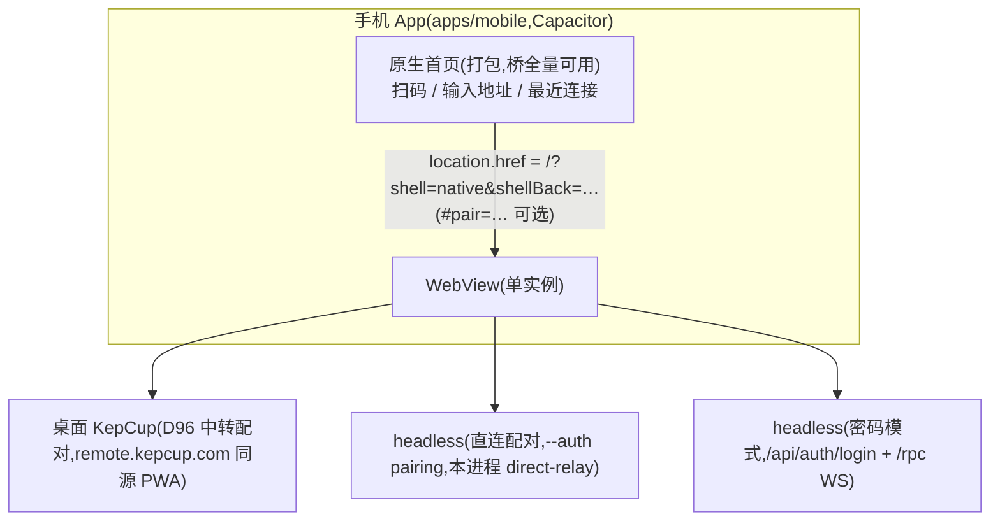

# 手机原生壳(D122)

> 状态:**设计定稿,P0 实施中**(2026-11-11)。背景:手机遥控(D96/D102)以 PWA 形态跑在手机浏览器里,浏览器环境是体验差的根因——微信等内置内核不可控、页内扫码(getUserMedia + jsQR)抖动、安装摩擦、配对凭证挂 sessionStorage 冷启动即丢、推送受限。本设计给手机端一个**原生 App 壳**,WebView 内加载所连服务端自己托管的 web 客户端。执行方案与验收记录见 [todo/mobile-shell.md](../../todo/mobile-shell.md)。

## 0 摘要

新建 `apps/mobile`(Capacitor + Svelte 5 + Tailwind,与 renderer 同栈):**原生首页**(扫码 / 手动输入地址 / 最近连接,打包进 App)+ **单 WebView** 加载「所连目标自己托管的 web 客户端」。web 客户端零重写、协议零改动;原生壳提供扫码、图标、安装、设备权限与后续推送通道。不做 React Native 重写:整个 Svelte 5 UI(对话 / 任务 / 设置 / 审批 / 窄屏布局)无法复用到 RN,双份维护成本不可接受——2026-11-11 与用户确认。

## 1 决策(D122)

1. **Capacitor 原生壳,不重写 UI**:手机 App = 原生首页 + WebView 加载所连服务端同源托管的 web 客户端(vite.config.web.ts 产物,桌面 D96 / headless D102 均已托管)。web 客户端与 core 版本永远匹配,这是 D102「服务端托管 web 构建」既定架构的直接延伸;App 内不再打包第二份客户端,避免 RPC 契约漂移。
2. **壳标记走 URL 查询参数,不依赖 Capacitor 桥**:`allowNavigation: ["*"]` 允许 WebView 留在任意目标源(局域网 IP:端口)。首页导航时统一附加 `?shell=native&shellBack=<首页地址>`,渲染层据此判断壳形态(模块级常量 `NATIVE_SHELL`,shell.ts 在模块加载期求值一次,与 ENDPOINT_KIND 同款);断开 = `history.go` 回首页(shellBack 已校验只接受本地源,普通浏览器伪造参数只会退化成 history 回退,不会导去外站)。**安全前提更正(2026-11-11 审查)**:早期设计假设「外部页面上桥不注入」(旧 issue capacitor#1389)——经查 Capacitor 8.6 源码,该前提**不成立**:iOS 的 WKUserScript 对该 WebView 一切导航生效,Android 通配规则同样暴露注入对象。即所连页面可调用全部已注册插件(相机、Preferences、CapacitorHttp 原生 HTTP、CapacitorCookies)。本设计的安全边界不建立在「桥不可用」上:凭证本来就是「所连服务端页面同源可读」的既定模型,插件暴露面是它的自然延伸;缓解方向(按当前 URL 是否本地源拦截插件分发)列 P3 评估,真机 PoC 列入验收。
3. **壳模式下配对凭证挂 localStorage**(renderer 小改):`WsTransport` 的 storage 本就可注入(`resolveShellCredentialStorage`);浏览器 PWA 仍是 sessionStorage(多标签页各自配对,design 46 既定),壳是单 WebView 单「标签页」,localStorage 让凭证跨冷启动保留,配对一次终身静默重连。设备身份(id)本来就在 localStorage,语义不变。已知取舍:普通浏览器里手工拼 `?shell=native` 也会进壳模式(凭证落 localStorage 且持久)——共享电脑上「关页即焚」保护被绕过;凭据撤销即时生效兜底,另加 `shellBack` 本地源校验防伪链。
4. **扫码用原生扫描器**:首页用官方 `@capacitor/barcode-scanner`(同时带 Package.swift 与 podspec,iOS SPM 工程直接集成;Android 走 ML Kit 引擎)——MLKit 独立插件(`@capacitor-mlkit/barcode-scanning`)只有 podspec,iOS SPM 不兼容,2026-11-11 实施时择优换用。原生扫码的自动对焦 / 环境光适配优于页内 jsQR;Gate 页内扫码保留为兜底(普通浏览器路径不变)。二维码内容不换格式:`#pair=` 配对链接(D96)与 headless 服务地址(http(s) URL)都被 App 识别。
5. **明文 http 只放行私网场景**:Android `network_security_config` 放行 cleartext;iOS ATS 例外(NSAllowsArbitraryLoadsInWebContent,只覆盖 web 内容、保留原生代码路径的默认 ATS)。公网部署仍建议 `--public-url` wss / 反代 TLS(与 apps/server/README.md 一致)。
6. **分发:Android APK 直装 + iOS TestFlight**(已确认),商店上架 P3 再议。App Store 对 WebView 应用有「最低功能性」审查风险,首版不进商店。
7. **永不做**:手机本地执行任何 loop(D96 既定边界,壳不改变它);App 内打包完整 web 客户端(契约漂移)。

## 2 目标与非目标

### 2.1 目标

- 首页三入口全通:**扫码连接**(桌面中转配对二维码 / headless 终端二维码 / 普通服务地址)、**手动输入地址**(headless 密码与配对模式)、**最近连接**(一键重连)。
- 三种连接方式闭环:桌面 D96 中转配对、headless 直连配对(`--auth pairing`)、headless 密码模式(默认,WebView Cookie 持久)。
- 冷启动(杀进程后重开)一键重连,配对凭证不丢。
- Android 硬件返回 = 先应用内返回(popstate,既有 back-navigation)再回首页;iOS 有常驻「断开」出口回首页。

### 2.2 非目标(P0–P2 不做)

- 推送通知(推送需 APNs/FCM + 转发服务,还要解决外部页面桥注入问题,P3 另案)。
- mDNS / Bonjour 局域网自动发现(需服务端advertise,另案)。
- `kepcup://` scheme 深链与「系统相机扫码直接拉起 App」(系统相机扫 http 链接只能进浏览器;P2 只做 scheme 预留)。
- 设备凭证迁 Keychain / Keystore(web storage 语义已够,加固另案)。
- 桌面 / 服务端协议任何改动(零协议改动)。

## 3 架构

- **首页→客户端交接**:首页解析扫描 / 输入结果(`@kepcup/shared` 的 `parsePairingLink`,D122 抽自 renderer):是 `#pair=` 配对链接 → 取 origin + hash 拼接导航;是 http(s) URL → `no-cors` fetch 做连通性预检(超时给警告但可强行连接)。导航 URL 一律带 `?shell=native&shellBack=<encodeURIComponent(首页URL)>`。
- **客户端壳模式**(renderer 三处小改,均以 `?shell=native` 为条件):①`getWebTransport()` 注入 localStorage 凭证存储;②WebShellGate 常驻「断开」按钮(导航到 shellBack);③web-main.ts 跳过 SW 注册(iOS WKWebView 无 SW,Android WebView 也无 PWA 场景)。
- **返回语义**:Android 硬件返回由 Capacitor 默认行为承担(WebView history goBack),与页内 back-navigation(popstate)自然复合:先退出应用内层级,再回首页。iOS 靠「断开」按钮。
- **iOS ATS / Android cleartext**:局域网明文 http 必须放行才能直连 headless;iOS 加 NSLocalNetworkUsageDescription / NSCameraUsageDescription。

## 4 工程落点

- `apps/mobile`:workspace 新包(pnpm,apps/* 已含)。首页 Vite + Svelte 5 + Tailwind 4(与 renderer 同版本);`capacitor.config.ts`:`appId: app.kepcup.desktop`(2026-11-11 定:App Store Connect 的 KepCup 记录是单记录多平台模式,Bundle ID `app.kepcup.desktop` 同时承载 macOS 与 iOS——SKU 才是 app.kepcup.mobile,接收构建看 Bundle ID)、`webDir: dist`、`server.allowNavigation: ["*"]`、cleartext 放行。原生工程(android/、ios/)由 `cap add` 生成并提交,配置改动(权限、ATS、network security config)随仓库走。图标:`pnpm --filter @kepcup/mobile icons` 从桌面端 KepCup.svg 渲染(iOS 单尺寸 1024 满幅无圆角 + Android legacy/round/自适应前景,零新增依赖)。
- vitest:根 `vitest.config.ts` 加 `mobile`(纯 TS)与 `mobile-svelte`(runes store,复用 desktop 的 svelte 解析插件,$lib 指向 apps/mobile)两个项目。
- ESLint 根配置自动覆盖;`android/**`、`ios/**` 原生产物与 `generate-icons-electron.cjs`(Electron 拉起的 CJS 工具链)加 ignore。
- 图标:`pnpm --filter @kepcup/mobile icons` 从单一源图(桌面 KepCup.svg)经 Electron 离屏壳渲染(iOS 单尺寸 1024 满幅无圆角 + Android legacy/round/自适应前景),零新增依赖;启动屏暂用系统默认,待需求。

## 5 与既有设计的边界

- design 46(D96):手机 = 纯遥控器、E2E 配对、哑中转——全部不变;本设计只换「容器」,把浏览器换成受控 WebView。P2 「原生壳再议」在此落位。
- design 49(D102):headless 三形态(直连配对 / 中转出站 / 密码)不变;服务端托管的 web 客户端即壳加载的内容。
- design 33(D82):窄屏布局即壳内 UI,无新增移动端布局代码(首页自身是新的,但只有三入口,极小)。
- design 57(多客户端协作):壳内 web 客户端与浏览器 PWA 同路,presence / 草稿租约 / 远端光标自动可用。

## 6 风险

- **桥暴露面(审查修正)**:壳内 WebView 对一切页面注入 Capacitor 桥(见 §1.2)——所连页面可调相机 / Preferences / CapacitorHttp / CapacitorCookies 等。凭证模型本就「所连服务端页面同源可读」,故不新增核心风险;缓解(按源拦截插件分发)列 P3,真机 PoC(两平台各验证一次外部页可调插件)列验收项。扫码路径加了首连确认卡(展示 host)防仿冒登录页钓鱼。
- WKWebView 无 Service Worker:壳内跳过注册即可,PWA 缓存只在浏览器路径有意义。
- App Store「最低功能性」审查:走 TestFlight / APK 分发规避;若未来上架,首页原生功能 + 原生扫码即功能性证据。
- 明文 http:iOS 用 InWebContent 例外(原生路径保持默认 ATS),Android 全放行——与「任意自建目标」的产品形态匹配,注释已论证枚举网段不可行。
